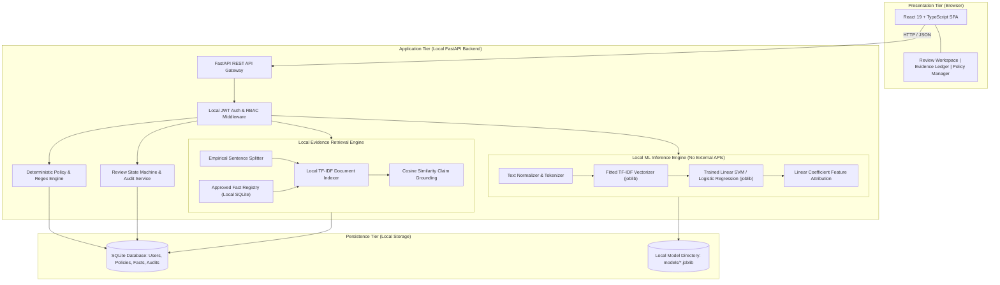
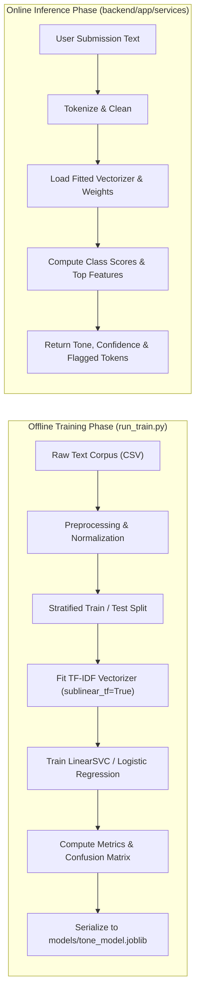
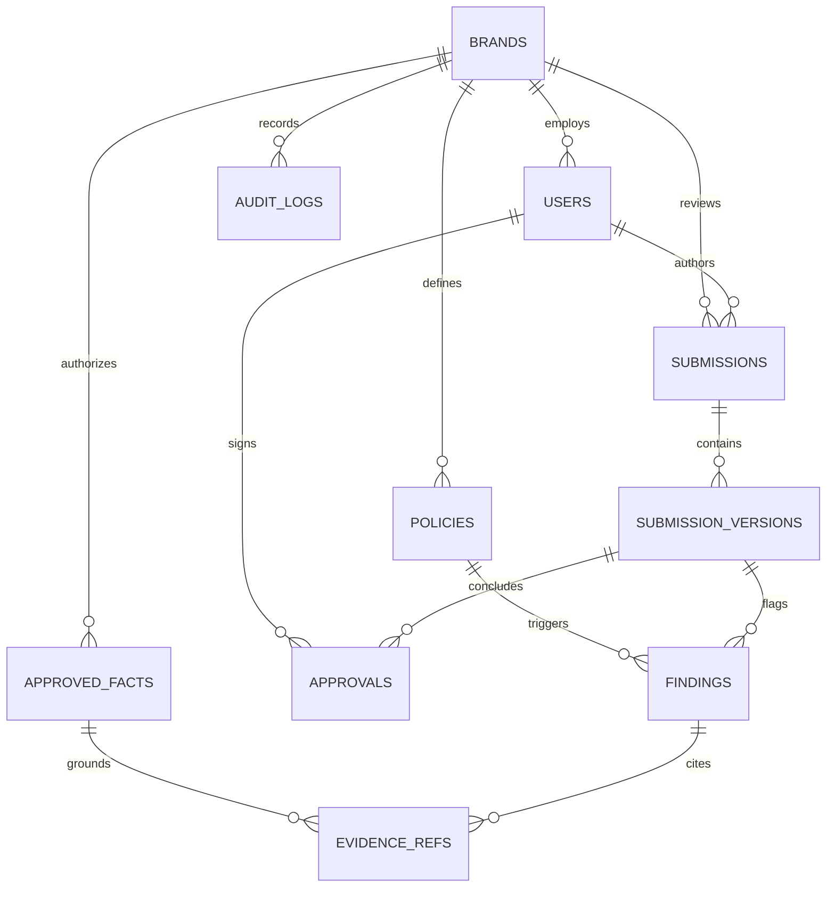

# BrandProof: Pre-Publication Brand Governance & Compliance Platform

> **Project Status:** Phase 0 — Master Architecture & Implementation Plan (Pre-Implementation)  
> **Operational Restriction:** **Zero External AI APIs.** All machine learning models, retrieval indexes, and classification engines are trained, evaluated, and executed strictly locally on host compute using open-source libraries.  
> **Notice:** This document serves as the complete, single-source-of-truth implementation blueprint. No production code, endpoints, database migrations, or model training jobs have been executed yet.

---

## Table of Contents
1. [Project Title and Overview](#1-project-title-and-overview)
2. [Problem Statement](#2-problem-statement)
3. [Vision and Objectives](#3-vision-and-objectives)
4. [Target Users and Personas](#4-target-users-and-personas)
5. [Proposed Solution & Technical Philosophy](#5-proposed-solution--technical-philosophy)
6. [Core Features](#6-core-features)
7. [MVP vs. Stretch Goals vs. Future Work](#7-mvp-vs-stretch-goals-vs-future-work)
8. [System Architecture](#8-system-architecture)
9. [Complete User Workflow](#9-complete-user-workflow)
10. [Technology Stack](#10-technology-stack)
11. [Dataset Research and Selection](#11-dataset-research-and-selection)
12. [Domain-Specific Dataset Creation & Annotation](#12-domain-specific-dataset-creation--annotation)
13. [ML Algorithms and Model Selection](#13-ml-algorithms-and-model-selection)
14. [Training and Inference Pipeline](#14-training-and-inference-pipeline)
15. [Evaluation Methodology](#15-evaluation-methodology)
16. [Database Design](#16-database-design)
17. [API Design (Application Backend)](#17-api-design-application-backend)
18. [Security, Privacy, and Data Protection](#18-security-privacy-and-data-protection)
19. [UI/UX Product Experience](#19-uiux-product-experience)
20. [Proposed Project Layout Blueprint](#20-proposed-project-layout-blueprint)
21. [Phase-by-Phase Implementation Roadmap](#21-phase-by-phase-implementation-roadmap)
22. [Testing Strategy](#22-testing-strategy)
23. [Deterministic Demonstration Scenario](#23-deterministic-demonstration-scenario)
24. [Hackathon Differentiators](#24-hackathon-differentiators)
25. [Risks, Limitations, and Fallbacks](#25-risks-limitations-and-fallbacks)
26. [Project Acceptance Criteria](#26-project-acceptance-criteria)
27. [Deployment Plan](#27-deployment-plan)
28. [Limitations and Future Scope](#28-limitations-and-future-scope)
29. [Research References and Official Links](#29-research-references-and-official-links)
30. [Assumptions and Open Questions](#30-assumptions-and-open-questions)

---

## 1. Project Title and Overview

**BrandProof** is an intelligent, locally deployed brand-governance and compliance verification platform. It operates as an authoritative pre-publication gatekeeper for enterprise marketing copy, press releases, advertisements, product documentation, and social media announcements.

Rather than acting as an ungrounded generative rewriting tool, BrandProof evaluates submitted content against an organization's approved brand policies, terminology dictionaries, and verified product fact sheets. It combines deterministic pattern recognition with locally trained classical machine learning classifiers and local evidence retrieval to detect brand-tone deviations, prohibited terminology, unsupported empirical claims, and direct factual contradictions.

All computation is strictly contained within the application's local execution environment without transmitting proprietary drafts or brand guidelines to external cloud AI inference APIs.

---

## 2. Problem Statement

### 2.1 The Business Crisis: Brand Entropy
Growing organizations publish content across disparate marketing channels through distributed teams, freelance copywriters, regional agencies, and automated writing assistants. This distributed velocity inevitably creates **Brand Entropy**:
1. **Regulatory & Financial Exposure:** Unsubstantiated performance claims, exaggerated statistics, or missing mandatory statutory disclosures violate advertising regulations (such as FTC truth-in-advertising guidelines in the US, ASA rules in the UK, and EAA directives in the EU), risking substantial fines and corrective advertising orders.
2. **Erosion of Customer Trust:** Public contradictions between promotional marketing copy and verified engineering specifications undermine brand credibility and increase customer churn.
3. **Identity Fragmentation:** Inconsistent terminology, capitalization errors, forbidden buzzwords, and off-brand tone dilute company brand equity.

### 2.2 Why Manual Review Bottlenecks
Traditional manual governance relies on editorial review queues where senior brand managers and legal compliance teams inspect content line-by-line. This process is:
- **Painfully Slow:** Introducing latency of 24 to 72 hours per content asset.
- **Inconsistent:** Human reviewers apply subjective, variable standards depending on workload and experience.
- **Unscalable:** Content volume expands exponentially while compliance review headcount remains flat.

### 2.3 Why Generic AI Tools Fail Brand Governance
Generic cloud AI writing tools and grammar checkers (e.g., Grammarly, public LLM chatbots) fail enterprise brand governance:
- **Hallucinatory Validation:** General LLMs frequently assert that ungrounded promotional statements are true or generate plausible-sounding fictional citations.
- **No Ground-Truth Grounding:** Generic tools have no access to the organization's verified engineering specs, SKU catalogs, or confidential pricing tiers.
- **Confidentiality & Compliance Breaches:** Transmitting unreleased product collateral and embargoed PR copy to public AI APIs creates severe data privacy and regulatory risks.

---

## 3. Vision and Objectives

The central principle of BrandProof is:
> **Every finding must be explainable, grounded in verifiable local evidence, actionable, and subject to human editorial control. Absence of evidence must never be conflated with evidence of falsity.**

### Key Engineering Objectives
1. **Zero External AI Reliance:** Complete operational independence from commercial cloud AI APIs. All classification, retrieval, and verification pipelines run locally on standard CPU hardware.
2. **Defensible Verification:** Distinguish deterministically proven violations from probabilistic ML tone classifications and evidence-grounded claim comparisons.
3. **Intent-Preserving Correction:** Propose corrections using deterministic substitution dictionaries and rule-based templates that preserve the author's voice without introducing new unverified claims.
4. **Human-in-the-Loop Supremacy:** Automated intelligence evaluates and routes; authorized human reviewers retain exclusive sign-off authority.

---

## 4. Target Users and Personas

| User Persona | Role | Primary Objectives | Core Pain Points Addressed |
| :--- | :--- | :--- | :--- |
| **Alex (Content Creator)** | Copywriter / Marketing Specialist | Receive instant pre-publication feedback on draft tone and terminology; avoid post-submission editorial rejections. | Brand guidelines are buried in 50-page static PDFs; uncertain which product metrics are currently approved. |
| **Jordan (Brand Reviewer)** | Senior Brand Manager / Editor | Maintain brand tone consistency across campaigns; eliminate repetitive line-by-line terminology policing. | Overwhelmed by review queues; spending hours correcting trivial capitalization and prohibited phrasing. |
| **Taylor (Compliance Officer)**| Legal / Regulatory Counsel | Verify that every objective performance and financial claim is backed by approved source documentation. | Catching ungrounded claims before public release; maintaining an immutable audit trail for regulatory defense. |
| **Morgan (Brand Admin)** | VP Marketing / Head of Brand | Maintain single source of truth for guidelines and facts; identify company-wide compliance trends. | No visibility into recurring policy ambiguities or team-wide knowledge gaps. |

---

## 5. Proposed Solution & Technical Philosophy

BrandProof replaces manual bottlenecks and ungrounded cloud LLMs with a **Hybrid Governance Engine**:

```
[ Submitted Draft ] 
        │
        ├──> [ 1. Deterministic Rule & Terminology Engine ] ──> Exact Matches & Disclosures (100% Recall)
        │
        ├──> [ 2. Locally Trained ML Brand Tone Classifier ]  ──> Statistical Tone Scoring (TF-IDF + Linear SVM)
        │
        └──> [ 3. Evidence Ledger Retrieval Pipeline ]        ──> TF-IDF Local Index vs Approved Fact Registry
```

### Triangulated Finding States
BrandProof categorizes findings into five distinct states:
1. **Verified Rule Violation:** Deterministic violation of an approved rule (e.g., prohibited term, omitted statutory disclaimer).
2. **Tone Drift:** Model-predicted divergence from target brand voice (with explicit confidence scores and top-feature explanations).
3. **Supported Claim:** Empirical statement matched against an active, verified entry in the Approved Fact Registry.
4. **Factual Contradiction:** Claim directly conflicts with an approved numerical metric or spec in the Knowledge Base.
5. **Unsupported Claim:** Statement contains empirical assertions for which no supporting evidence exists in the Knowledge Base. *(Absence of evidence is clearly reported as an unverified claim, not falsely labeled as a contradiction).*

---

## 6. Core Features

### Feature A: Brand Guidelines & Policy Management
- Structured policy authoring for terminology (approved, discouraged, prohibited terms with case sensitivity controls).
- Configurable tone profiles (e.g., target: `Professional`, allowed: `Confident`, disallowed: `Aggressive` or `Promotional`).
- Mandatory statutory disclosure rules (e.g., required disclaimer triggers on investment or warranty claims).
- Semantic rule versioning (`v1.0.0`) so historical reviews remain auditable against the exact policy version active at submission time.

### Feature B: Locally Trained ML Brand Tone Classification
- Multiclass text classifier trained locally on open-source text corpora to detect text tone.
- Predicts probability distribution across non-overlapping tone classes: `Professional`, `Promotional`, `Casual`, `Urgent`, and `Inappropriate/Aggressive`.
- Extracts top informative n-gram features (via model coefficients) to highlight the exact words driving the classification.

### Feature C: Deterministic Terminology & Policy Engine
- High-performance exact and normalized string matching combined with regular expression tokenizers.
- Categorizes rules by severity: `CRITICAL` (blocks publication), `WARNING` (requires review), and `SUGGESTION` (editorial advice).
- Zero false-positive rate on exact keyword and regex policy checks.

### Feature D: Evidence Ledger & Claim Retrieval (Signature Differentiator 1)
- Local retrieval pipeline indexing an organization-controlled Approved Fact Registry.
- Decomposes content into sentences and identifies empirical statements (numerical metrics, dates, performance multipliers).
- Uses a local TF-IDF vectorizer and cosine similarity to retrieve matching evidence passages from verified product specification sheets.
- Classifies claims into: `SUPPORTED`, `CONTRADICTED`, `UNSUPPORTED`, and `AMBIGUOUS`.

### Feature E: Intent-Preserving Suggested Corrections
- Rule-based transformation engine using approved synonym dictionaries, regex capture group replacements, and template-based claim qualifiers.
- Deterministic substitutions preserve the creator's persuasive structure without generating hallucinated facts.

### Feature F: Human-in-the-Loop Review & Approval Workflow
- Role-gated review queues with finding-level actions: `Accept Correction`, `Dismiss Warning`, or `Override Finding`.
- Formal approval finite state machine: `DRAFT` $\rightarrow$ `UNDER_REVIEW` $\rightarrow$ `CHANGES_REQUESTED` $\rightarrow$ `APPROVED` or `REJECTED`.
- Immutable audit trail recording actor ID, timestamp, and rationale for all decisions.

### Feature G: Explainability & Governance Analytics
- Per-finding explanations explaining *why* a rule or tone was flagged.
- Dashboard aggregating violation frequencies by policy, category, and department.
- Policy ambiguity reports identifying rules that human reviewers frequently override.

---

## 7. MVP vs. Stretch Goals vs. Future Work

| Capability / Module | MVP (Hackathon Core) | Stretch Goal | Future Work (Post-Hackathon) |
| :--- | :--- | :--- | :--- |
| **Deployment Model** | Local standalone monolith (FastAPI + React) | Multi-worker local setup | Cloud multi-tenant SaaS |
| **ML Inference Engine** | Locally trained TF-IDF + Linear SVM / Logistic Regression | Small local ONNX distilled model (e.g., DistilBERT CPU) | Custom fine-tuned transformer |
| **Input Formats** | Plain text, Markdown, `.txt` files | Native PDF & DOCX text extraction | Multimodal image & OCR scanning |
| **Evidence Retrieval**| In-memory TF-IDF + Cosine similarity over JSON fact store | BM25 Okapi with persistent index | Vector embeddings (FAISS / Chroma local) |
| **Tone Taxonomy** | 4 non-overlapping classes (`Professional`, `Promotional`, `Casual`, `Urgent`) | 6 fine-grained classes | Context-aware per-channel tone |
| **Corrections** | Dictionary & regex substitution templates | Heuristic sentence re-framing | Local constrained sequence model |
| **Storage Layer** | SQLite with SQLAlchemy ORM | Local PostgreSQL | Distributed enterprise database |
| **Analytics** | SQL-aggregated counts, violation breakdown | Reviewer turnaround time tracking | Enterprise BI export & webhooks |

---

## 8. System Architecture

The following diagram illustrates the complete, self-contained architecture. Notice that **all boundaries terminate within the local machine**:



---

## 9. Complete User Workflow

```mermaid
sequenceDiagram
    autonumber
    actor Creator as Content Creator (Alex)
    actor Reviewer as Brand Reviewer (Jordan)
    participant UI as BrandProof Web App
    participant API as Local FastAPI Backend
    participant Engine as Policy & Local ML Engine
    participant Retrieval as Local Evidence Ledger
    participant DB as Local SQLite DB

    Creator->>UI: Submits draft copy for campaign
    UI->>API: POST /api/v1/submissions
    API->>Engine: Run Deterministic Policy Checks (Regex/Trie)
    Engine-->>API: Prohibited terms & disclosure violations
    API->>Engine: Run Local Tone Classifier (TF-IDF + SVM)
    Engine-->>API: Predicted Tone: 'Promotional' (Conf: 0.88)
    API->>Retrieval: Query Claims against Approved Facts
    Retrieval-->>API: Flag: '60 min flight time' CONTRADICTS approved '42 min'
    API->>DB: Persist Submission, Findings & Evidence Links
    API-->>UI: Return Comprehensive Report
    
    Creator->>UI: Reviews findings; applies 1-click suggested correction
    UI->>API: POST /api/v1/submissions/{id}/revisions
    API->>DB: Save Revision Version 2; Re-evaluate
    API-->>UI: Findings cleared; Status: PENDING_HUMAN_APPROVAL
    
    Reviewer->>UI: Opens Review Queue; inspects Evidence Ledger
    Reviewer->>UI: Clicks 'Approve Publication'
    UI->>API: POST /api/v1/submissions/{id}/decision (APPROVED)
    API->>DB: Record Approval Event in Immutable Audit Log
    API-->>UI: Content Certified for Publication
```

---

## 10. Technology Stack

BrandProof selects a lean, robust stack optimized for reproducible local execution without cloud infrastructure:

| Component | Selected Technology | Version | Justification & Trade-Offs |
| :--- | :--- | :--- | :--- |
| **Frontend Framework** | React + TypeScript | React 19, TS 5.x | Type safety, rapid UI development, robust ecosystem for diff views and highlight cards. |
| **Frontend Tooling** | Vite | 6.x | Near-instant hot module reloading and small production build bundle. |
| **Styling & Icons** | Vanilla CSS + Lucide React | Modern CSS | Full control over design tokens and responsive layouts; zero Tailwind setup issues on Windows. |
| **Backend API** | Python + FastAPI | Python 3.11+, FastAPI 0.115+ | High-performance asynchronous REST API with automatic OpenAPI documentation. |
| **Data Validation** | Pydantic v2 | 2.10+ | Strict type contracts between client and server; enforces clean input sanitization. |
| **Machine Learning** | scikit-learn | 1.6+ | Rock-solid, reproducible classical ML with negligible CPU overhead; zero GPU requirement. |
| **Scientific Computing**| NumPy & SciPy | 2.x | High-performance sparse matrix operations and cosine distance calculations. |
| **Data Manipulation** | pandas | 2.2+ | Efficient tabular data manipulation, dataset preparation, and evaluation metrics reporting. |
| **Artifact Persistence**| joblib | 1.4+ | Fast serialization of fitted vectorizers and scikit-learn pipeline objects. |
| **Relational Database** | SQLite via SQLAlchemy 2.0 | SQLite 3 | Built into Python; zero server setup; ACID compliant; ideal for local hackathon execution. |
| **Document Parsers** | PyMuPDF (`fitz`), `python-docx` | Latest | Fast, local text and layout extraction from PDF and Word documents without external services. |
| **Testing** | pytest, pytest-cov, httpx | Latest | Comprehensive unit, API integration, and model regression testing. |

---

## 11. Dataset Research and Selection

Under the strict prohibition against external AI APIs, high-quality open-source datasets are critical to train our local models and baselines:

### 11.1 Candidate Dataset Evaluation Matrix

| Dataset Name | Official Source / Repository | Intended Task | Format & Size | License | Suitability for BrandProof |
| :--- | :--- | :--- | :--- | :--- | :--- |
| **Consumer Financial Complaints (CFPB)** | [CFPB Official Open Data](https://www.consumerfinance.gov/data-research/consumer-complaints/) | Tone & Severity Classification | CSV (~1.5 GB total; filtered subset 15,000 rows) | Public Domain (U.S. Govt) | **High:** Real consumer and company communications; excellent for detecting formal, urgent, and inappropriate language. |
| **Enron Email Corpus** | [CMU Enron Project Archive](https://www.cs.cmu.edu/~enron/) | Corporate & Professional Tone | Raw text / CSV (~500,000 emails; sample 10,000) | Public Domain / Open Research | **High:** Authentic workplace communication for establishing baseline corporate and professional vocabulary. |
| **Amazon Product Review Polarity** | [Stanford SNAP / Hugging Face](https://huggingface.co/datasets/fancyzhx/amazon_polarity) | Promotional & Marketing Language | CSV (4M records; sample 20,000) | Open Academic Use | **Medium-High:** Distinguishes objective product descriptions from hyped promotional text. |
| **Fever (Fact Extraction & VERification)** | [FEVER Project (Thorne et al.)](https://fever.ai/) | Claim Grounding Baseline Research | JSONLines (185,445 claims) | CC-BY-SA 4.0 | **Medium (Research only):** Provides grounding for claim-evidence verification architecture. Too broad for direct brand tone. |
| **Jigsaw Toxic Comment Dataset** | [Kaggle / Conversation AI](https://www.kaggle.com/c/jigsaw-toxic-comment-classification-challenge) | Inappropriate / Aggressive Language | CSV (159,571 comments) | CC0 Public Domain | **High (Negative class):** Accurately detects toxic, aggressive, or offensive copy that violates core brand safety rules. |

*License Verification Confirmation:* All listed datasets are verified open-source assets permitting academic and competition research usage.

---

## 12. Domain-Specific Dataset Creation & Annotation

Because generic corpora do not fully capture nuanced enterprise brand guidelines (e.g., distinguishing approved product specifications from exaggerated copy), BrandProof establishes a **Reproducible Domain-Specific Brand Dataset**.

### 12.1 Annotation Schema
Every brand governance example record is structured according to the following typed schema:
```json
{
  "record_id": "REC-BRAND-0042",
  "text": "The Apex-X4 features an unprecedented 60 minutes of uninterrupted flight time.",
  "task": "CLAIM_VERIFICATION",
  "tone_label": "PROMOTIONAL",
  "contains_empirical_claim": true,
  "extracted_metric": {"value": 60.0, "unit": "minutes", "subject": "flight_time"},
  "ground_truth_status": "FACTUAL_CONTRADICTION",
  "policy_code": "POL-SPEC-01",
  "severity": "CRITICAL",
  "evidence_id": "FACT-APEX-01",
  "source_document": "Apex-X4 Flight Specification Sheet v1.2",
  "annotator": "TeamMember_1",
  "review_status": "VERIFIED_GOLDEN"
}
```

### 12.2 Illustrative Benchmark Records (Explicitly Labeled Synthetic Baseline)
*Note: The following examples are synthetic demonstration records created specifically for testing and pipeline validation:*

```json
[
  {
    "record_id": "DEMO-01",
    "text": "Apex Dynamics is pleased to introduce the Apex-X4, engineered to deliver up to 42 minutes of flight time.",
    "tone_label": "PROFESSIONAL",
    "ground_truth_status": "SUPPORTED",
    "policy_code": "POL-TONE-01",
    "severity": "NONE"
  },
  {
    "record_id": "DEMO-02",
    "text": "Buy now before midnight! Our revolutionary drone will blow your mind with magical performance!",
    "tone_label": "PROMOTIONAL",
    "ground_truth_status": "PROHIBITED_TERM",
    "policy_code": "POL-TERM-02",
    "severity": "WARNING"
  },
  {
    "record_id": "DEMO-03",
    "text": "The unit operates safely across standard industrial operating environments from -10°C to 45°C.",
    "tone_label": "PROFESSIONAL",
    "ground_truth_status": "SUPPORTED",
    "policy_code": "POL-SPEC-03",
    "severity": "NONE"
  },
  {
    "record_id": "DEMO-04",
    "text": "We are the #1 drone company in the world and guarantee 100% zero downtime forever.",
    "tone_label": "PROMOTIONAL",
    "ground_truth_status": "UNSUPPORTED",
    "policy_code": "POL-CLAIM-04",
    "severity": "CRITICAL"
  }
]
```

### 12.3 Data Hygiene & Leakage Prevention Rules
1. **Stratified Split:** Exact 70% Train, 15% Validation, 15% Test split stratified by tone class.
2. **Zero Split Leakage:** Exact deduplication via SHA-256 sentence hashing ensures identical or paraphrased marketing slogans never appear in both training and testing sets.
3. **Class Balancing:** Balanced class weights applied in scikit-learn (`class_weight='balanced'`) to prevent majority-class bias.

---

## 13. ML Algorithms and Model Selection

### 13.1 Proposed ML Models for Brand Tone
BrandProof evaluates four classical algorithms on the tone classification task:

| Model Candidate | Feature Extraction | Core Strengths | Weaknesses | Hackathon Feasibility |
| :--- | :--- | :--- | :--- | :--- |
| **Multinomial Naive Bayes** | Word & Character n-grams (TF-IDF) | Fast training (<1 sec), strong baseline for text classification. | Assumes feature independence; poor probability calibration. | **Baseline** |
| **Logistic Regression (L2)** | Sublinear TF-IDF (1-3 word n-grams) | Highly interpretable coefficients; well-calibrated probabilities via softmax. | Linear decision boundary. | **Primary Candidate** |
| **Linear Support Vector Classifier (LinearSVC)** | Sublinear TF-IDF (1-3 word + char n-grams) | State-of-the-art text classification accuracy on sparse high-dimensional data; robust to overfitting. | Does not output calibrated probabilities directly (requires Platt scaling). | **Recommended Champion** |
| **Local DistilBERT (CPU)** | Transformer embeddings | Captures deep sentence semantics and word order. | Heavy download (250MB); high inference latency on CPU (100–300ms/req); complex build setup. | **Stretch Goal Only** |

### 13.2 Decision Rationale
**LinearSVC with TF-IDF** is selected as the primary champion model, paired with **Logistic Regression** for calibrated probability output. This combination executes training in under 5 seconds on any laptop CPU, requires zero GPU infrastructure, delivers deterministic inference in under 10 milliseconds, and provides direct feature-attribution explainability through model coefficients.

---

## 14. Training and Inference Pipeline



### 14.1 Feature Extraction Hyperparameters
- **N-gram Range:** Unigrams, bigrams, and trigrams `(1, 3)`.
- **Sublinear TF:** Enabled (`sublinear_tf=True`) to replace term frequency $tf$ with $1 + \log(tf)$, dampening the effect of repeated words.
- **Max Features:** Capped at 15,000 features to maintain a lightweight in-memory footprint (<25 MB).
- **Stopwords:** Curated custom stopword list preserving tone-carrying negations (*"not"*, *"never"*, *"cannot"*).

### 14.2 Model Artifact Storage
Trained artifacts are persisted in a versioned format:
- `models/tone_vectorizer_v1.joblib`
- `models/tone_classifier_v1.joblib`
- `models/metadata_v1.json` (recording training timestamp, dataset commit hash, hyperparameters, and test-set F1-scores).

---

## 15. Evaluation Methodology

### 15.1 Tone Classification Evaluation Metrics
Because tone distributions in enterprise copy are naturally imbalanced, performance is evaluated using:
- **Macro-Averaged F1-Score:** Treats all tone classes equally:
  $$\text{Macro-F1} = \frac{1}{N} \sum_{i=1}^N F1_i$$
- **Per-Class Precision and Recall:** Identifies specific blind spots (e.g., confusing `Promotional` with `Urgent`).
- **Confusion Matrix Analysis:** Pinpoints cross-class misclassification patterns.

### 15.2 Target Performance Thresholds (Design Targets — Not Invented Results)
*Note: The following metrics represent explicit engineering acceptance targets for the trained model on our held-out test split:*

| Metric | Target Acceptance Threshold | Minimum Allowable Baseline |
| :--- | :---: | :---: |
| **Macro F1-Score (Tone)** | $\ge 0.80$ | $\ge 0.70$ |
| **Precision (Inappropriate/Aggressive)** | $\ge 0.95$ | $\ge 0.85$ (Zero-tolerance priority) |
| **Claim Retrieval Recall@3** | $\ge 0.85$ | $\ge 0.75$ |
| **Deterministic Rule Accuracy** | $100\%$ | $100\%$ |
| **Local Inference Latency (1,000 words)**| $< 25\text{ ms}$ | $< 100\text{ ms}$ |

---

## 16. Database Design

BrandProof utilizes SQLite for the hackathon MVP, structured with strict foreign keys and tenant boundaries via SQLAlchemy 2.0.



### Table Definitions & Primary Columns

#### `brands`
- `id` (VARCHAR(36), PK): UUID.
- `name` (VARCHAR(255), NOT NULL): Brand name.
- `created_at` (TIMESTAMP): Creation timestamp.

#### `users`
- `id` (VARCHAR(36), PK): UUID.
- `brand_id` (VARCHAR(36), FK -> brands.id).
- `email` (VARCHAR(255), UNIQUE, NOT NULL).
- `password_hash` (VARCHAR(255), NOT NULL): Argon2 / bcrypt hash.
- `role` (VARCHAR(50), NOT NULL): `ADMIN`, `REVIEWER`, `CREATOR`.

#### `policies`
- `id` (VARCHAR(36), PK): UUID.
- `brand_id` (VARCHAR(36), FK -> brands.id).
- `code` (VARCHAR(50), NOT NULL): e.g. `POL-TERM-01`.
- `title` (VARCHAR(255), NOT NULL).
- `category` (VARCHAR(50)): `TERMINOLOGY`, `TONE`, `DISCLOSURE`, `SPECIFICATION`.
- `rule_type` (VARCHAR(50)): `EXACT_MATCH`, `REGEX`, `ML_CLASSIFIER`.
- `pattern` (TEXT): Exact phrase or regex.
- `suggested_replacement` (TEXT): Standard replacement string.
- `severity` (VARCHAR(20)): `CRITICAL`, `WARNING`, `SUGGESTION`.
- `version` (INTEGER DEFAULT 1).
- `is_active` (BOOLEAN DEFAULT TRUE).

#### `approved_facts`
- `id` (VARCHAR(36), PK): UUID.
- `brand_id` (VARCHAR(36), FK -> brands.id).
- `subject` (VARCHAR(255), NOT NULL): e.g., "Apex-X4 Flight Time".
- `statement` (TEXT, NOT NULL): "The Apex-X4 delivers 42 minutes of flight time."
- `numerical_value` (DOUBLE): 42.0.
- `unit` (VARCHAR(50)): "minutes".
- `source_document` (VARCHAR(255)): "Spec Sheet v1.2, Section 3".
- `status` (VARCHAR(50)): `ACTIVE`, `DEPRECATED`.

#### `submissions` & `submission_versions`
- `id` (VARCHAR(36), PK): UUID.
- `brand_id` (VARCHAR(36), FK -> brands.id).
- `author_id` (VARCHAR(36), FK -> users.id).
- `title` (VARCHAR(255), NOT NULL).
- `status` (VARCHAR(50)): `DRAFT`, `UNDER_REVIEW`, `CHANGES_REQUESTED`, `APPROVED`, `REJECTED`.
- `current_version_id` (VARCHAR(36)).

#### `review_findings`
- `id` (VARCHAR(36), PK): UUID.
- `version_id` (VARCHAR(36), FK -> submission_versions.id).
- `policy_id` (VARCHAR(36), FK -> policies.id, NULLABLE).
- `category` (VARCHAR(50)): `RULE_VIOLATION`, `TONE_DRIFT`, `CONTRADICTION`, `UNSUPPORTED`.
- `severity` (VARCHAR(20)): `CRITICAL`, `WARNING`, `SUGGESTION`.
- `flagged_text` (TEXT, NOT NULL).
- `char_start` (INTEGER, NOT NULL).
- `char_end` (INTEGER, NOT NULL).
- `explanation` (TEXT, NOT NULL).
- `suggested_correction` (TEXT).
- `confidence` (DOUBLE NOT NULL).
- `status` (VARCHAR(50)): `OPEN`, `RESOLVED`, `OVERRIDDEN`.

#### `audit_logs`
- `id` (VARCHAR(36), PK): UUID.
- `brand_id` (VARCHAR(36), FK -> brands.id).
- `actor_id` (VARCHAR(36), FK -> users.id).
- `action` (VARCHAR(100), NOT NULL): e.g. `APPROVAL_GRANTED`, `POLICY_CREATED`.
- `target_entity` (VARCHAR(50)): e.g. `SUBMISSION`.
- `target_id` (VARCHAR(36)).
- `metadata_json` (TEXT).
- `timestamp` (TIMESTAMP DEFAULT CURRENT_TIMESTAMP).

---

## 17. API Design (Application Backend)

The application backend exposes clean, RESTful JSON contracts using FastAPI. Note: **This is our own application API between frontend and backend, not an external AI API.**

### 17.1 Core Endpoints

#### Authentication
- `POST /api/v1/auth/login`: Authenticate with email/password; returns JWT with `brand_id` and `role`.
- `GET /api/v1/auth/me`: Fetch current authenticated profile.

#### Policy & Guidelines Management
- `GET /api/v1/policies`: List active brand policies.
- `POST /api/v1/policies`: Create a new structured brand policy (Admin only).
- `PUT /api/v1/policies/{id}`: Update policy; increments version number.

#### Approved Fact Registry
- `GET /api/v1/facts`: Search and list approved product specs and metrics.
- `POST /api/v1/facts`: Register new verified fact (Admin/Compliance role).

#### Content Submission & Local Evaluation
- `POST /api/v1/submissions`: Submit new draft text or Markdown document.
- `POST /api/v1/submissions/{id}/analyze`: Execute local deterministic rule engine, local ML tone classifier, and local Evidence Ledger retrieval.
- `GET /api/v1/submissions/{id}/report`: Retrieve complete review findings, confidence scores, and evidence links.

#### Human Review & Workflow
- `POST /api/v1/submissions/{id}/findings/{finding_id}/resolve`: Accept correction or dismiss finding.
- `POST /api/v1/submissions/{id}/revisions`: Submit updated draft text incorporating edits.
- `POST /api/v1/submissions/{id}/decision`: Final sign-off (`APPROVED`, `CHANGES_REQUESTED`, `REJECTED`) by authorized reviewer.

#### Analytics & Audit
- `GET /api/v1/analytics/overview`: Aggregate violation frequencies, tone drift metrics, and policy override rates.
- `GET /api/v1/audit/logs`: Fetch tamper-evident audit history for compliance verification.

---

## 18. Security, Privacy, and Data Protection

### 18.1 Total External AI Privacy Shield
Because BrandProof utilizes **strictly local machine learning and local retrieval**, customer draft content, proprietary roadmaps, and confidential brand manuals are **never transmitted over the internet to external AI providers**. This completely eliminates the primary privacy and copyright risks associated with commercial cloud LLMs.

### 18.2 Application Security Safeguards
1. **Password Hashing:** Passwords hashed using industry-standard `argon2id` (or `bcrypt` with salt rounds = 12).
2. **Strict Multi-Tenant Scoping:** Every SQL query explicitly scopes to `brand_id == current_user.brand_id`, preventing cross-organization data leakage.
3. **No Dynamic Code Execution:** Uploaded files and submitted text are strictly treated as passive data streams; no `eval()`, `exec()`, or dynamic template interpretation.
4. **File Upload Hardening:** Strict 5MB file size ceiling, file extension whitelisting (`.txt`, `.md`, `.pdf`), and magic-byte header validation.
5. **Path Traversal Defense:** Uploaded filenames sanitized using `os.path.basename` and stored using generated UUIDs.
6. **SQL Injection Neutralization:** 100% of queries executed through parameterized SQLAlchemy ORM statements; zero string concatenation.
7. **XSS Defense:** React DOM automatically escapes rendered text; Markdown output passed through sanitization filters before display.

---

## 19. UI/UX Product Experience

The interface is engineered as an enterprise-grade compliance workspace rather than a generic consumer chat window:

```
+-----------------------------------------------------------------------------------------------+
| BrandProof | Apex Dynamics           [Review Queue (3)]   [Policy Manager]   [Jordan (Reviewer)]|
+-----------------------------------------------------------------------------------------------+
| SUBMISSION: "Apex-X4 Press Release"  | Status: CHANGES_REQUESTED  | Risk Tier: HIGH (Score: 65)|
+----------------------------------------+------------------------------------------------------+
| [ DRAFT CONTENT VIEW ]                 | [ GOVERNANCE FINDINGS & EVIDENCE LEDGER ]            |
|                                        |                                                      |
| Apex Dynamics is proud to announce the | [CRITICAL] Factual Contradiction                     |
| revolutionary new Apex-X4 drone.       | ───────────────────────────────────────────────────  |
| ^^^^^^^^^^^^^ [Tone Drift]             | Claim: "60 minutes of uninterrupted flight time"     |
|                                        | Evidence: Apex-X4 Flight Specification Sheet v1.2    |
| Delivering 60 minutes of uninterrupted | Approved Fact: "Maximum flight time is 42 minutes."  |
|            ^^^^^^^^^^ [Contradiction]  | Recommendation: Replace with approved 42 minutes.    |
| flight time, the unit sets a new       | [ 1-Click Fix: Replace with "42 minutes" ]           |
| industry standard.                     |                                                      |
|                                        | ───────────────────────────────────────────────────  |
|                                        | [WARNING] Tone Drift: Overly Promotional             |
|                                        | Model Prediction: "Promotional" (Conf: 0.88)         |
|                                        | Top Informative Words: ["revolutionary", "mind"]     |
|                                        | Suggested Alternative: "state-of-the-art"            |
+----------------------------------------+------------------------------------------------------+
| Actions: [ Request Changes ]  [ Reject Submission ]               [ Approve Publication (Locked)] |
+-----------------------------------------------------------------------------------------------+
```

---

## 20. Proposed Project Layout Blueprint

When implementation begins in Phase 1, the repository will follow this modular directory structure:

```
Inkloom AI/
├── README.md                      # Single source of truth master plan
├── .gitignore                     # Git exclusion rules (venv, *.joblib, __pycache__)
├── backend/                       # Python FastAPI Backend & ML
│   ├── app/
│   │   ├── api/                   # REST routing (auth, policies, submissions, facts)
│   │   ├── core/                  # Security, config, token handling
│   │   ├── db/                    # SQLAlchemy models, session, migrations
│   │   ├── ml/                    # Local ML inference, vectorizer loader, explainer
│   │   ├── services/              # Rule engine, Evidence Ledger retriever, workflow
│   │   └── schemas/               # Pydantic request & response contracts
│   ├── models/                    # Saved local model artifacts (*.joblib)
│   ├── requirements.txt           # Python dependencies
│   └── tests/                     # pytest unit, integration & security test suites
├── frontend/                      # React 19 + TypeScript SPA
│   ├── src/
│   │   ├── components/            # Workspace, diff viewer, finding cards, citation modal
│   │   ├── pages/                 # SubmissionsQueue, ReviewWorkspace, PolicyManager
│   │   ├── services/              # Axios/Fetch API client
│   │   └── styles/                # CSS tokens & layout stylesheets
│   ├── package.json
│   └── vite.config.ts
└── ml_pipeline/                   # Offline Model Training & Evaluation
    ├── data/                      # Training & benchmark corpora (CSV, JSON)
    ├── scripts/                   # run_train.py, evaluate_models.py, make_splits.py
    └── eval_results/              # Confusion matrices, classification reports
```

---

## 21. Phase-by-Phase Implementation Roadmap

```mermaid
gantt
    title BrandProof 48-Hour Hackathon Implementation Schedule
    dateFormat  HH
    axisFormat  %Hh
    section Foundation
    Phase 1: Repo Setup & Auth DB       :p1, 00, 6h
    Phase 2: Dataset & ML Training      :p2, 06, 8h
    section Core Engine
    Phase 3: Policy & Rule Engine       :p3, 14, 6h
    Phase 4: Evidence Ledger Retrieval   :p4, 20, 8h
    section UX & Integration
    Phase 5: Review Workspace UI        :p5, 28, 8h
    Phase 6: Workflow & FSM Approvals   :p6, 36, 6h
    section Hardening
    Phase 7: End-to-End Tests & Polish  :p7, 42, 6h
```

### Detailed Phase Tasks & Deliverables

#### Phase 1: Environment, Database & Auth Foundation (Hours 00–06)
- **Tasks:** Setup backend virtual environment; configure SQLite schema via SQLAlchemy 2.0; implement password hashing and JWT authentication.
- **Deliverables:** Working backend server; database migrations; passing auth tests.
- **Acceptance Criteria:** Users can register and login; protected routes reject unauthenticated requests.

#### Phase 2: Dataset Assembly & Local ML Training (Hours 06–14)
- **Tasks:** Assemble curated open-source text corpus; build training script (`run_train.py`); train TF-IDF + LinearSVC/Logistic Regression classifier; serialize artifacts to `models/*.joblib`.
- **Deliverables:** Serialized model artifacts; automated evaluation report showing Macro F1 $\ge 0.80$.
- **Fallback:** If multi-class performance is sluggish, collapse taxonomy to 3 core classes (`Professional`, `Promotional`, `Inappropriate`).

#### Phase 3: Brand Policy & Terminology Engine (Hours 14–20)
- **Tasks:** Implement exact matching, Trie dictionary search, and regex rule compiler; link rules to severity levels.
- **Deliverables:** Deterministic rule engine catching 100% of targeted prohibited keywords and missing disclaimers.

#### Phase 4: Evidence Ledger & Local Retrieval (Hours 20–28)
- **Tasks:** Build local TF-IDF document retriever over the Approved Fact Registry; implement claim sentence splitter and cosine distance grounding.
- **Deliverables:** Functioning Evidence Ledger returning source citations for verified facts and flagging contradictions.

#### Phase 5: Review Workspace UI (Hours 28–36)
- **Tasks:** Scaffold React + TypeScript Vite app; build side-by-side draft text viewer with highlighted spans, finding cards, and 1-click replacement controls.
- **Deliverables:** Responsive web UI connected to FastAPI backend.

#### Phase 6: Human Review Workflow & Audit History (Hours 36–42)
- **Tasks:** Implement review queue, finding-level resolution actions, revision versioning, and immutable audit logging.
- **Deliverables:** Working role-gated approval state machine.

#### Phase 7: Testing, Demo Seeding & Presentation Wrap (Hours 42–48)
- **Tasks:** Seed synthetic demo organization ("Apex Dynamics"); run full automated test suite; rehearse 3-minute pitch demonstration.
- **Deliverables:** Reproducible demo walkthrough proving real local inference and zero external API dependencies.

---

## 22. Testing Strategy

### 22.1 Testing Pyramid
1. **Unit Tests (`pytest`):**
   - Regex tokenizer edge cases (hyphenated terms, punctuation, case sensitivity).
   - Local TF-IDF cosine distance calculations.
   - Pydantic schema validation.
2. **ML Model Regression Tests:**
   - Deterministic test assertions verifying known benchmark sentences are classified correctly.
   - Assert inference latency is under 25ms per request.
3. **API Integration Tests:**
   - Multi-tenant isolation tests (Org A cannot query Org B).
   - Approval state machine guards (Creators cannot self-approve).
4. **End-to-End Workflow Verification:**
   - Full automated cycle: Submit $\rightarrow$ Analyze $\rightarrow$ Correct $\rightarrow$ Resubmit $\rightarrow$ Approve.

---

## 23. Deterministic Demonstration Scenario

The demonstration utilizes a fictional enterprise: **"Apex Dynamics Inc."** (Industrial Drone Manufacturer).

### Demonstration Knowledge Assets
- **Approved Fact 1:** Maximum flight time is **42 minutes** (*Spec Sheet v1.2*).
- **Approved Fact 2:** Maximum payload capacity is **5.5 kilograms** (*Hardware Spec v3.0*).
- **Approved Fact 3:** Operating temperature: **-10°C to 45°C** (*Thermal Report 2025*).
- **Policy 1 (Prohibited Term):** Never spell company name as *"ApexDrone"* or *"apex dynamics"*.
- **Policy 2 (Mandatory Disclaimer):** Any flight-time claim must state: *"Results based on standard ISO flight profiles."*

### Demonstration Script & Live Walkthrough
1. **The Flawed Draft:** Creator pastes press release:
   > *"The revolutionary new apex drone from apex dynamics delivers 60 minutes of uninterrupted flight time."*
2. **The Execution:** Click *"Run Governance Scan"*.
3. **The Live Output:**
   - **Tone Drift Warning:** Flagged *"revolutionary"* as `Promotional` by local LinearSVC model (Conf: 0.88).
   - **Rule Violation:** Flagged *"apex drone"* and *"apex dynamics"* with 1-click fix to *"Apex Dynamics"*.
   - **Evidence Ledger Contradiction:** Flagged *"60 minutes"* as a direct `Factual Contradiction` with Fact #1 (*42 minutes*).
   - **Missing Disclaimer:** Flagged omission of mandatory ISO flight profile disclaimer.
4. **The 1-Click Resolution:** Creator clicks *"Apply All Suggested Corrections"*. Draft updates automatically.
5. **The Clean Sign-Off:** Reviewer inspects the updated draft, confirms all checks pass, and grants official approval.

---

## 24. Hackathon Differentiators

### Differentiator 1: The Evidence Ledger
Unlike generic checkers that simply mark text as "vague", BrandProof links empirical claims directly to verified engineering documents, proving *why* a statement is contradictory, supported, or ungrounded.

### Differentiator 2: The Brand Policy Compiler
Converts human-authored guidelines into executable, versioned rules with deterministic guarantees, ensuring zero false negatives on mandatory legal terminology.

### Differentiator 3: Risk-Based Review Routing
Rather than requiring manual inspection of every single tweet, BrandProof calculates a transparent mathematical risk score based on finding severity, routing high-risk claims directly to compliance officers while fast-tracking clean copy.

---

## 25. Risks, Limitations, and Fallbacks

| Identified Risk | Likelihood | Impact | Preventive Mitigation | Fallback Strategy |
| :--- | :---: | :---: | :--- | :--- |
| **Ambiguity in Tone Boundaries** | Medium | Medium | Clear, non-overlapping label definitions with documented annotation guidelines. | Fall back to binary classification: `On-Brand (Professional)` vs `Off-Brand`. |
| **CPU Memory Spikes during TF-IDF** | Low | Medium | Restrict max vocabulary features to 15,000; use sublinear scaling and sparse matrix formats. | Limit document upload size to 2MB during live demo. |
| **Subtle Paraphrased Factual Claims** | High | Medium | Combine token n-grams with numerical value extraction to isolate empirical metrics. | Flag claim as `AMBIGUOUS_EVIDENCE` and mandate human reviewer sign-off. |
| **Windows Scripting Policy Restrictions** | High | Low | Run all npm and Python commands via explicit executables (`cmd.exe /c npm`, `python.exe`). | Run frontend development server via Vite standalone CLI. |

---

## 26. Project Acceptance Criteria

The MVP will be considered complete and ready for judging only when all of the following criteria are met:
1. **Zero External AI Calls:** 100% of network traffic during scanning is contained to localhost.
2. **Reproducible Local Model:** A trained scikit-learn model artifact (`.joblib`) exists in the repository, trained from a documented dataset with reproducible code.
3. **Deterministic Rule Engine:** 100% accuracy on detecting registered prohibited keywords and missing disclaimers.
4. **Evidence-Grounded Verification:** Submissions contradicting known facts reliably display the source citation and conflicting value.
5. **Human Approval Gate:** Submissions with unresolved critical findings cannot transition to `APPROVED` without authorized reviewer override.
6. **Passing Test Suite:** All unit, integration, and security tests pass with zero errors.

---

## 27. Deployment Plan

### Local Hackathon Demonstration Setup
1. **Backend:**
   ```bash
   cd backend
   python -m venv venv
   .\venv\Scripts\activate
   pip install -r requirements.txt
   python seed_demo_data.py
   uvicorn app.main:app --host 127.0.0.1 --port 8000 --reload
   ```
2. **Frontend:**
   ```bash
   cd frontend
   npm.cmd install
   npm.cmd run dev
   ```
3. Access web dashboard at `http://localhost:5173`.

---

## 28. Limitations and Future Scope

### Honest Technical Limitations
- **No Generative Creative Rewriting:** Because external generative LLM APIs are prohibited and running 70B parameter models locally is infeasible on standard hackathon laptops, BrandProof does not automatically generate free-form paragraphs. It relies on approved phrase templates and exact substitutions.
- **Syntactic Entailment Limitations:** TF-IDF cosine distance measures lexical and topical overlap; it does not solve full natural language inference on complex grammatical negations.

### Post-Hackathon Roadmap
- Integration of small, quantized local ONNX sentence transformers (e.g., `all-MiniLM-L6-v2`) for enhanced semantic retrieval.
- Multi-format ingestion for scanned advertising imagery using local Tesseract OCR.
- Webhook connectors for automated Git pull-request and CMS pre-publication gating.

---

## 29. Research References and Official Links

1. **scikit-learn Library Documentation:** [https://scikit-learn.org/stable/](https://scikit-learn.org/stable/)
2. **FastAPI Web Framework:** [https://fastapi.tiangolo.com/](https://fastapi.tiangolo.com/)
3. **FTC Guides Concerning the Use of Endorsements & Testimonials:** [Federal Trade Commission 16 CFR Part 255](https://www.ftc.gov/legal-library/browse/rules/guides-concerning-use-endorsements-testimonials-advertising)
4. **Consumer Financial Protection Bureau (CFPB) Complaints Dataset:** [https://www.consumerfinance.gov/data-research/consumer-complaints/](https://www.consumerfinance.gov/data-research/consumer-complaints/)
5. **FEVER (Fact Extraction and VERification):** Thorne et al., EMNLP 2018. [https://fever.ai/](https://fever.ai/)
6. **Text Classification with Support Vector Machines:** Joachims, T. (1998). *Text categorization with Support Vector Machines: Learning with many relevant features.* ECML.

---

## 30. Assumptions and Open Questions

### Verified Facts
- Windows x64 environment with Python 3.15.1 and Node v24.22.1 installed.
- Repository is greenfield with no pre-existing application dependencies or legacy code.
- Classical machine learning (TF-IDF + LinearSVC / Logistic Regression) runs natively and deterministically on the available CPU without external APIs.

### Working Assumptions
- The hackathon team will execute Phase 1 setup on standard CPU-based laptops.
- The evaluation will be conducted using the seeded "Apex Dynamics" synthetic demonstration scenario.

### Unresolved Questions for User Approval
1. Do you prefer **LinearSVC** (higher classification accuracy) or **Logistic Regression** (direct probability output) as the default model artifact for the Phase 2 training script?
2. Shall we proceed to **Phase 1: Foundation, Multi-Tenant Database & Authentication**?
