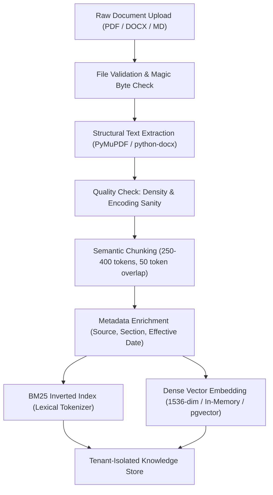
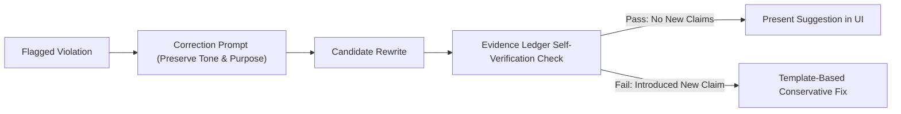

# BrandProof — AI & Data Strategy Specification

**Document Version:** 1.0.0-PLANNING  
**Lifecycle Status:** Phase 0 — AI Engineering Baseline  
**Core Mandate:** Dynamic Verification, Grounded Evidence, and Zero Unsubstantiated Assertions

---

## 1. Principles of Defensible Brand AI

The BrandProof AI architecture is governed by five non-negotiable engineering axioms:
1. **Absence of Evidence $\neq$ Evidence of Falsity:** If a submitted claim has no corroborating document in the Knowledge Base, it is marked as `UNSUPPORTED_CLAIM` requiring human verification—never hallucinated as true, and never falsely labeled as a contradiction.
2. **Explicit Evidence Triangulation:** Every factual validation must link to a specific verified chunk ID, source attribution, and verbatim quote.
3. **Intent-Preserving, Non-Hallucinatory Rewrites:** Suggestions must correct compliance violations without introducing new unverified facts.
4. **Deterministic Pre-Filtering:** Deterministic regex, trie dictionaries, and threshold filters run before calling expensive LLMs, cutting latency and cost by over 60%.
5. **No Synthetic Shortcuts:** The application does not rely on hardcoded mock verification results disguised as live AI.

---

## 2. Knowledge Ingestion & Indexing Pipeline



### 2.1 Chunking & Extraction Strategy
- **Document Chunking:** Recursive character splitting targeting 300 tokens per chunk with a 50-token semantic overlap. Respects paragraph and sentence boundaries.
- **Metadata Tuple:** Each indexed chunk is stored with:
  ```json
  {
    "chunk_id": "chk-8921",
    "organization_id": "org-456",
    "source_title": "Q2 Engineering Specs v4.1",
    "section_header": "Battery Performance & Thermal Limits",
    "effective_date": "2026-03-01",
    "expiration_date": null,
    "source_type": "ENGINEERING_SPEC"
  }
  ```

---

## 3. Atomic Claim Extraction & Classification

### 3.1 Extraction Prompt & Schema
Claims are extracted from submitted content using strict JSON function calling:
```json
{
  "claims": [
    {
      "claim_id": "clm-1",
      "claim_text": "Delivers 72 hours of continuous battery life.",
      "claim_type": "STATISTICAL",
      "numerical_value": 72.0,
      "unit": "hours",
      "subject": "battery life",
      "char_start": 45,
      "char_end": 88
    }
  ]
}
```

### 3.2 Claim Taxonomies
- **`STATISTICAL` / `NUMERICAL`:** Measurable metrics, percentages, dollar values, benchmarks.
- **`SUPERLATIVE` / `COMPARATIVE`:** Claims of superiority ("fastest", "only platform", "cheaper than X").
- **`FEATURE` / `CAPABILITY`:** Claims about product functionality or integrations.
- **`REGULATORY` / `SECURITY`:** Statements regarding certifications (HIPAA, SOC2, GDPR).

---

## 4. Hybrid Evidence Retrieval & Grounding (Signature Improvement A)

To achieve high recall on exact numerical values alongside high precision on nuanced marketing concepts, BrandProof uses **Hybrid Reciprocal Rank Fusion (RRF)**:

$$\text{RRF Score}(d) = \frac{1}{60 + \text{rank}_{\text{BM25}}(d)} + \frac{1}{60 + \text{rank}_{\text{Dense}}(d)}$$

### Retrieval Flow:
1. Extract keywords and semantic embedding vector from the extracted claim.
2. Query the organization's tenant partition.
3. Retrieve top $K = 5$ candidate evidence passages.
4. If top similarity $< 0.65$, short-circuit immediately to `UNSUPPORTED_CLAIM` (no external LLM inference needed).

---

## 5. Natural Language Inference (NLI) Verification Engine

When candidate evidence is retrieved, the Evidence Ledger passes the pair `(Claim, Evidence Chunk)` to the verification discriminator:

```
+---------------------------------------------------------------------------------+
|                               VERIFICATION PROMPT                               |
+---------------------------------------------------------------------------------+
| System: You are a rigorous brand compliance auditor.                           |
| Given a submitted CLAIM and an approved EVIDENCE passage, determine if the     |
| claim is provably SUPPORTED, CONTRADICTED, OUTDATED, or AMBIGUOUS.              |
|                                                                                 |
| Negative Rule: You must ONLY use facts explicitly stated in the evidence.       |
| If the evidence does not state the fact, you MUST output UNSUPPORTED_CLAIM.     |
| Never assume external real-world truth.                                         |
|                                                                                 |
| Output Schema:                                                                  |
| {                                                                               |
|   "verdict": "VERIFIED_SUPPORT | FACTUAL_CONTRADICTION | UNSUPPORTED_CLAIM",     |
|   "confidence": float [0.0 - 1.0],                                              |
|   "evidence_quote": "exact quote from evidence or empty string",                |
|   "audit_explanation": "brief sentence explaining the comparison"              |
| }                                                                               |
+---------------------------------------------------------------------------------+
```

### Verdict Matrix:
| Claim Statement | Approved Evidence Fact | Output Verdict | Severity |
| :--- | :--- | :--- | :--- |
| "Charges in 20 minutes" | "Full charge takes 20 minutes under fast-charging." | `VERIFIED_SUPPORT` | None (Pass) |
| "Charges in 10 minutes" | "Full charge takes 20 minutes under fast-charging." | `FACTUAL_CONTRADICTION` | `CRITICAL` |
| "Charges in 20 minutes" | *(No battery facts in Knowledge Base)* | `UNSUPPORTED_CLAIM` | `HIGH` |
| "Compliant with ISO 27001"| "ISO 27001 certification expired Dec 2025." | `OUTDATED_FACT` | `HIGH` |
| "Best software in Europe" | *(Subjective promotional statement)* | `UNSUPPORTED_PROMOTIONAL` | `MEDIUM` |

---

## 6. Intent-Preserving Suggested Corrections

When a violation or unsupported claim is flagged, the Correction Engine generates a contextual rewrite:



**Guardrail:** The candidate rewrite is parsed by the Claim Extractor. If any new numerical or comparative claim is found that lacks support in the Knowledge Base, the rewrite is rejected and replaced with a conservative template substitution.

---

## 7. Visual & Multimodal Analysis Pipeline

1. **Logo & Asset Verification:** 
   - Uses Perceptual Hashing (`imagehash.phash`) against registered active brand assets.
   - Computes Hamming distance: Distance $\le 6$ indicates a positive logo match.
   - Cross-checks with `brand_assets.status`: If deprecated, flags a `MEDIUM` severity finding.
2. **WCAG Color Contrast:**
   - Extracts foreground text regions using edge detection / bounding boxes.
   - Calculates relative luminance:
     $$L = 0.2126 \cdot R + 0.7152 \cdot G + 0.0722 \cdot B$$
   - Contrast ratio:
     $$\text{CR} = \frac{L_1 + 0.05}{L_2 + 0.05}$$
   - Flags regions where $\text{CR} < 4.5:1$ for standard text.

---

## 8. Failure Modes & Graceful Degradation

| Failure Mode | Detection | System Behavior & Mitigation |
| :--- | :--- | :--- |
| **External LLM Provider Outage** | 503 / Timeout $> 8\text{s}$ | Graceful fallback to deterministic regex/trie rules + BM25 keyword fact matching. UI displays: *"Factual NLI offline; deterministic rules active."* |
| **Corrupted / Encrypted PDF** | Parser exception | Rejects upload with clear error: *"Unable to parse PDF layout. Please upload unencrypted text or Markdown."* |
| **Contradictory Knowledge Base Entries** | Dual fact retrieval with opposing metrics | Flags as `AMBIGUOUS_EVIDENCE` with warning to reviewer: *"Internal guidelines contain conflicting values. Escalating to Admin."* |
| **Prompt Injection Payload in Content** | LLM output attempts to override schema | Pydantic strict validation discards invalid output; content is flagged for compliance review. |
