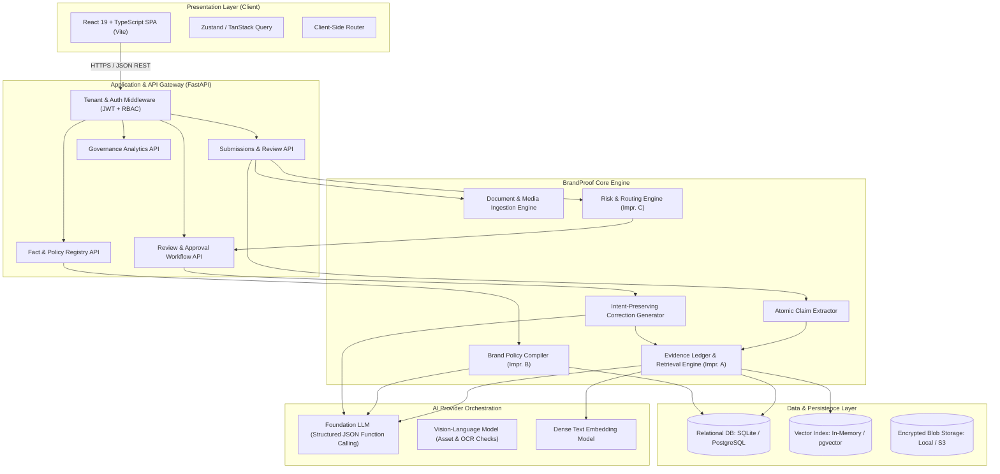
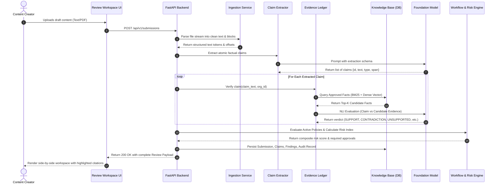

# BrandProof — System Architecture Specification

**Document Version:** 1.0.0-PLANNING  
**Lifecycle Status:** Phase 0 — Architectural Baseline  

---

## 1. System Overview & Component Topology

BrandProof is architected as a **Modular Monolith** designed for operational simplicity during hackathon development and seamless horizontal scaling in enterprise production.



---

## 2. Component Responsibilities

| Subsystem | Primary Responsibilities | Technologies |
| :--- | :--- | :--- |
| **Presentation Tier (`frontend/`)** | Interactive Review Workspace, side-by-side text diffing, citation viewer, policy authoring cards, analytics dashboard. | React 19, TypeScript, Vite, Tailwind CSS, Lucide Icons, Canvas API. |
| **API Gateway & Auth (`backend/app/api`)** | Request routing, JWT validation, role-based authorization, rate limiting, and request payload schema validation. | FastAPI, Pydantic v2, Python-Jose, Passlib. |
| **Ingestion Pipeline (`services/parser.py`)** | Parse plain text, Markdown, PDF, DOCX, and images; extract textual hierarchy, bounding boxes, and metadata. | PyMuPDF (`fitz`), `python-docx`, Pillow. |
| **Policy Compiler (`services/compiler.py`)** | Deconstruct brand manuals into atomic deterministic/contextual rules; versioning and sign-off lifecycle. | Structured LLM extraction, Regex/Trie compiler. |
| **Evidence Ledger Engine (`services/ledger.py`)** | Claim decomposition, hybrid retrieval (BM25 + Cosine), multi-factor NLI comparison, and source citation generation. | NumPy / SciPy (in-memory cosine), BM25Okapi, LLM structured verification. |
| **Risk & Routing Engine (`services/workflow.py`)** | Compute deterministic risk score, route drafts to qualified roles, manage FSM state transitions, and audit logs. | Python State Machine, SQLAlchemy async session. |
| **Persistence Store (`backend/app/db`)** | Tenant-isolated relational storage, vector indexing, historical review snapshots, audit trail. | SQLAlchemy 2.0, SQLite (Local Dev) / PostgreSQL 16 + pgvector (Prod). |

---

## 3. Detailed Data Flows & Pipelines

### 3.1 Content Review Execution Flow



---

## 4. AI Orchestration & Evidence Triangulation

To prevent hallucinations and guarantee defensible outputs, BrandProof enforces a **Three-Gate AI Pipeline**:

### Gate 1: Claim Extraction Gate
- Model receives submitted content and is restricted via Pydantic schema to extract only empirical statements (statistics, performance claims, product capabilities, pricing, and comparative statements).
- Model is explicitly prohibited from judging truthfulness at this step.

### Gate 2: Evidence Retrieval & Grounding Gate
- Hybrid search over tenant-isolated approved facts:
  $$\text{Score}(d, q) = \alpha \cdot \text{Score}_{\text{BM25}}(d, q) + (1 - \alpha) \cdot \text{CosineSim}(\vec{e}_d, \vec{e}_q)$$
  where $\alpha = 0.4$ balances exact numerical match with semantic intent.
- If top similarity score is below the confidence threshold ($\tau = 0.65$), the system **automatically flags the claim as `UNSUPPORTED_CLAIM` without calling the LLM**. This drastically cuts inference cost and eliminates false-positive verification.

### Gate 3: Natural Language Inference (NLI) Verification Gate
- When candidate evidence is retrieved, the LLM is prompted with a strict discriminator:
  ```json
  {
    "verdict": "VERIFIED_SUPPORT | FACTUAL_CONTRADICTION | AMBIGUOUS_EVIDENCE | OUTDATED_FACT",
    "rationale": "Exact explanation quoting evidence text",
    "exact_quote": "Exact substring from retrieved fact",
    "confidence": 0.95
  }
  ```
- **Negative Constraint:** If the evidence passage does not explicitly assert the claim, the model is instructed to output `UNSUPPORTED_CLAIM`. It is programmatically forbidden from using external training data to validate enterprise claims.

---

## 5. Technology Decisions & Architecture Trade-Offs (ADR Summary)

### ADR-01: Modular Monolith vs. Microservices
- **Decision:** Modular Monolith using FastAPI.
- **Rationale:** Microservices introduce RPC overhead, distributed tracing complexity, and deployment fragility unsuited for a high-velocity hackathon. A modular monolith maintains clean domain boundaries (`api/`, `services/`, `db/`) and can be split into microservices post-hackathon if enterprise load demands.

### ADR-02: Storage Layer: Dual-Dialect SQLAlchemy (SQLite Dev -> PostgreSQL Prod)
- **Decision:** Architect SQLAlchemy 2.0 models to support both SQLite with an in-memory vector indexing fallback and PostgreSQL with `pgvector`.
- **Rationale:** The local development environment does not currently have PostgreSQL installed. Requiring local Docker/Postgres setup creates installation friction. By writing standard ANSI SQL with SQLAlchemy and implementing a lightweight cosine similarity fallback for vector search in SQLite mode, the app runs instantly with **zero local dependencies**, while migrating cleanly to managed PostgreSQL in cloud deployment.

### ADR-03: Structured JSON Outputs vs. Free-Form Text
- **Decision:** Mandate strict JSON Schema generation via Pydantic schemas on all AI calls.
- **Rationale:** Free-form text outputs require brittle regex scraping and fail frequently. Pydantic-enforced schemas guarantee type safety, character-span validation, and deterministic front-end rendering.

### ADR-04: Deterministic Risk Scoring vs. End-to-End LLM Judgment
- **Decision:** Compute risk scores through a deterministic weighted mathematical formula based on classified findings, rather than asking the LLM "How risky is this draft?".
- **Rationale:** LLM self-assessed risk is subjective, non-reproducible, and easily manipulated via prompt injection. Deterministic formulaic scoring ensures enterprise auditability and consistent governance routing.
