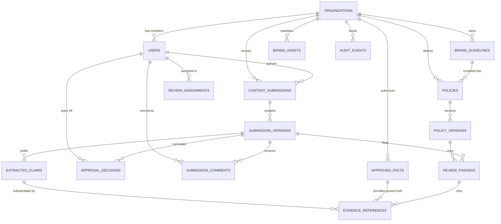

# BrandProof — Database Design Specification

**Document Version:** 1.0.0-PLANNING  
**Lifecycle Status:** Phase 0 — Relational Schema Baseline  
**Dialect Compatibility:** Dual-Dialect Support (SQLite 3 for zero-dependency local execution; PostgreSQL 16 + pgvector for production)

---

## 1. Entity-Relationship Diagram (ERD)



---

## 2. Table Schemas & Column Definitions

### 2.1 Core Multi-Tenancy & Identity

#### `organizations`
Represents an enterprise tenant.
```sql
CREATE TABLE organizations (
    id VARCHAR(36) PRIMARY KEY, -- UUID v4
    name VARCHAR(255) NOT NULL,
    slug VARCHAR(100) UNIQUE NOT NULL,
    created_at TIMESTAMP WITH TIME ZONE DEFAULT CURRENT_TIMESTAMP,
    updated_at TIMESTAMP WITH TIME ZONE DEFAULT CURRENT_TIMESTAMP
);
CREATE INDEX idx_org_slug ON organizations(slug);
```

#### `users`
Represents an authorized platform user.
```sql
CREATE TABLE users (
    id VARCHAR(36) PRIMARY KEY,
    organization_id VARCHAR(36) NOT NULL REFERENCES organizations(id) ON DELETE CASCADE,
    email VARCHAR(255) NOT NULL,
    hashed_password VARCHAR(255) NOT NULL,
    full_name VARCHAR(255) NOT NULL,
    role VARCHAR(50) NOT NULL CHECK (role IN ('ADMIN', 'COMPLIANCE_REVIEWER', 'BRAND_REVIEWER', 'CREATOR')),
    is_active BOOLEAN DEFAULT TRUE,
    created_at TIMESTAMP WITH TIME ZONE DEFAULT CURRENT_TIMESTAMP,
    CONSTRAINT uq_user_org_email UNIQUE (organization_id, email)
);
CREATE INDEX idx_users_org ON users(organization_id);
```

---

### 2.2 Brand Knowledge Base & Policy Management

#### `brand_guidelines`
Source brand manuals, guideline PDFs, and uploaded documents.
```sql
CREATE TABLE brand_guidelines (
    id VARCHAR(36) PRIMARY KEY,
    organization_id VARCHAR(36) NOT NULL REFERENCES organizations(id) ON DELETE CASCADE,
    title VARCHAR(255) NOT NULL,
    file_path VARCHAR(500) NOT NULL,
    file_format VARCHAR(20) NOT NULL, -- 'PDF', 'DOCX', 'MARKDOWN', 'TEXT'
    uploaded_by VARCHAR(36) NOT NULL REFERENCES users(id),
    status VARCHAR(50) DEFAULT 'ACTIVE', -- 'DRAFT', 'ACTIVE', 'ARCHIVED'
    created_at TIMESTAMP WITH TIME ZONE DEFAULT CURRENT_TIMESTAMP
);
CREATE INDEX idx_guidelines_org ON brand_guidelines(organization_id);
```

#### `policies` & `policy_versions`
The executable brand governance rules. `policy_versions` guarantees that historical reviews point to immutable rule snapshots.
```sql
CREATE TABLE policies (
    id VARCHAR(36) PRIMARY KEY,
    organization_id VARCHAR(36) NOT NULL REFERENCES organizations(id) ON DELETE CASCADE,
    guideline_id VARCHAR(36) REFERENCES brand_guidelines(id) ON DELETE SET NULL,
    code VARCHAR(50) NOT NULL, -- e.g. 'POL-VOICE-01', 'POL-TERM-04'
    title VARCHAR(255) NOT NULL,
    category VARCHAR(50) NOT NULL, -- 'TONE', 'TERMINOLOGY', 'MESSAGING', 'LEGAL_DISCLOSURE', 'ACCESSIBILITY'
    rule_type VARCHAR(50) NOT NULL, -- 'DETERMINISTIC_REGEX', 'CONTEXTUAL_LLM'
    current_version_id VARCHAR(36), -- Points to active policy_versions.id
    created_at TIMESTAMP WITH TIME ZONE DEFAULT CURRENT_TIMESTAMP,
    CONSTRAINT uq_policy_org_code UNIQUE (organization_id, code)
);

CREATE TABLE policy_versions (
    id VARCHAR(36) PRIMARY KEY,
    policy_id VARCHAR(36) NOT NULL REFERENCES policies(id) ON DELETE CASCADE,
    version_number INTEGER NOT NULL, -- 1, 2, 3...
    is_mandatory BOOLEAN NOT NULL DEFAULT TRUE, -- TRUE = blocks publication without approval
    rule_config JSON NOT NULL, -- Regex patterns, forbidden term lists, or few-shot prompts
    source_passage TEXT NOT NULL, -- Exact citation from original guideline document
    status VARCHAR(50) NOT NULL DEFAULT 'DRAFT', -- 'DRAFT', 'APPROVED', 'DEPRECATED'
    approved_by VARCHAR(36) REFERENCES users(id),
    approved_at TIMESTAMP WITH TIME ZONE,
    created_at TIMESTAMP WITH TIME ZONE DEFAULT CURRENT_TIMESTAMP,
    CONSTRAINT uq_policy_version UNIQUE (policy_id, version_number)
);
CREATE INDEX idx_policy_versions_active ON policy_versions(policy_id, status);
```

#### `approved_facts`
Authoritative factual registry (numbers, metrics, releases, pricing, specs).
```sql
CREATE TABLE approved_facts (
    id VARCHAR(36) PRIMARY KEY,
    organization_id VARCHAR(36) NOT NULL REFERENCES organizations(id) ON DELETE CASCADE,
    subject VARCHAR(255) NOT NULL, -- e.g. 'Battery Life', 'Encryption Standard'
    statement TEXT NOT NULL, -- e.g. 'BrandProof delivers 48 hours of battery backup under normal usage.'
    numerical_value DOUBLE PRECISION, -- e.g. 48.0
    unit VARCHAR(50), -- e.g. 'hours'
    effective_date DATE NOT NULL,
    expiration_date DATE, -- NULL if permanent until superseded
    status VARCHAR(50) NOT NULL DEFAULT 'ACTIVE', -- 'DRAFT', 'ACTIVE', 'EXPIRED', 'DEPRECATED'
    source_reference VARCHAR(500) NOT NULL, -- e.g. 'Engineering Spec v2.4, Section 5.1'
    embedding_json TEXT, -- Serialized vector representation for SQLite; vector(1536) for PostgreSQL
    created_by VARCHAR(36) NOT NULL REFERENCES users(id),
    created_at TIMESTAMP WITH TIME ZONE DEFAULT CURRENT_TIMESTAMP,
    updated_at TIMESTAMP WITH TIME ZONE DEFAULT CURRENT_TIMESTAMP
);
CREATE INDEX idx_facts_org_status ON approved_facts(organization_id, status);
```

#### `brand_assets`
Registered logos, approved imagery, and visual badges.
```sql
CREATE TABLE brand_assets (
    id VARCHAR(36) PRIMARY KEY,
    organization_id VARCHAR(36) NOT NULL REFERENCES organizations(id) ON DELETE CASCADE,
    name VARCHAR(255) NOT NULL,
    asset_type VARCHAR(50) NOT NULL, -- 'PRIMARY_LOGO', 'SECONDARY_LOGO', 'BADGE', 'PRODUCT_STILL'
    file_path VARCHAR(500) NOT NULL,
    phash VARCHAR(64), -- Perceptual hash for image similarity
    aspect_ratio DOUBLE PRECISION,
    min_width_px INTEGER,
    min_contrast_ratio DOUBLE PRECISION DEFAULT 4.5,
    status VARCHAR(50) NOT NULL DEFAULT 'ACTIVE', -- 'ACTIVE', 'DEPRECATED'
    created_at TIMESTAMP WITH TIME ZONE DEFAULT CURRENT_TIMESTAMP
);
CREATE INDEX idx_assets_org ON brand_assets(organization_id, status);
```

---

### 2.3 Content Submissions & Review Engine

#### `content_submissions` & `submission_versions`
Supports revision rounds. When an author edits a draft following feedback, a new `submission_version` is created while maintaining the parent submission thread.
```sql
CREATE TABLE content_submissions (
    id VARCHAR(36) PRIMARY KEY,
    organization_id VARCHAR(36) NOT NULL REFERENCES organizations(id) ON DELETE CASCADE,
    author_id VARCHAR(36) NOT NULL REFERENCES users(id),
    title VARCHAR(255) NOT NULL,
    channel VARCHAR(100), -- 'BLOG', 'SOCIAL_MEDIA', 'PRESS_RELEASE', 'AD_COPY'
    current_status VARCHAR(50) NOT NULL DEFAULT 'DRAFT', -- 'DRAFT', 'UNDER_REVIEW', 'CHANGES_REQUESTED', 'APPROVED', 'REJECTED'
    risk_tier VARCHAR(20) DEFAULT 'LOW', -- 'LOW', 'MEDIUM', 'HIGH', 'CRITICAL'
    risk_score INTEGER DEFAULT 0, -- 0 to 100
    created_at TIMESTAMP WITH TIME ZONE DEFAULT CURRENT_TIMESTAMP,
    updated_at TIMESTAMP WITH TIME ZONE DEFAULT CURRENT_TIMESTAMP
);
CREATE INDEX idx_submissions_org_status ON content_submissions(organization_id, current_status);

CREATE TABLE submission_versions (
    id VARCHAR(36) PRIMARY KEY,
    submission_id VARCHAR(36) NOT NULL REFERENCES content_submissions(id) ON DELETE CASCADE,
    version_number INTEGER NOT NULL DEFAULT 1,
    raw_content TEXT NOT NULL,
    content_format VARCHAR(20) NOT NULL DEFAULT 'TEXT', -- 'TEXT', 'MARKDOWN', 'HTML'
    extracted_text TEXT NOT NULL,
    created_at TIMESTAMP WITH TIME ZONE DEFAULT CURRENT_TIMESTAMP,
    CONSTRAINT uq_sub_version UNIQUE (submission_id, version_number)
);
```

#### `extracted_claims`
Discrete testable claims extracted from the submitted text.
```sql
CREATE TABLE extracted_claims (
    id VARCHAR(36) PRIMARY KEY,
    submission_version_id VARCHAR(36) NOT NULL REFERENCES submission_versions(id) ON DELETE CASCADE,
    claim_text TEXT NOT NULL,
    claim_type VARCHAR(50) NOT NULL, -- 'STATISTICAL', 'PROMOTIONAL', 'FEATURE', 'COMPARATIVE'
    char_start INTEGER NOT NULL,
    char_end INTEGER NOT NULL,
    created_at TIMESTAMP WITH TIME ZONE DEFAULT CURRENT_TIMESTAMP
);
CREATE INDEX idx_claims_version ON extracted_claims(submission_version_id);
```

#### `review_findings`
Actionable governance and compliance issues identified by the engine.
```sql
CREATE TABLE review_findings (
    id VARCHAR(36) PRIMARY KEY,
    submission_version_id VARCHAR(36) NOT NULL REFERENCES submission_versions(id) ON DELETE CASCADE,
    extracted_claim_id VARCHAR(36) REFERENCES extracted_claims(id) ON DELETE SET NULL,
    policy_version_id VARCHAR(36) REFERENCES policy_versions(id) ON DELETE SET NULL,
    issue_category VARCHAR(50) NOT NULL, -- 'FACTUAL_CONTRADICTION', 'UNSUPPORTED_CLAIM', 'OUTDATED_FACT', 'PROHIBITED_TERM', 'TONE_MISMATCH', 'ACCESSIBILITY'
    severity VARCHAR(20) NOT NULL, -- 'LOW', 'MEDIUM', 'HIGH', 'CRITICAL'
    char_start INTEGER NOT NULL,
    char_end INTEGER NOT NULL,
    flagged_text TEXT NOT NULL,
    explanation TEXT NOT NULL,
    suggested_correction TEXT,
    confidence_score DOUBLE PRECISION NOT NULL,
    status VARCHAR(50) NOT NULL DEFAULT 'OPEN', -- 'OPEN', 'ACCEPTED', 'DISMISSED', 'OVERRIDDEN'
    reviewer_comment TEXT,
    created_at TIMESTAMP WITH TIME ZONE DEFAULT CURRENT_TIMESTAMP
);
CREATE INDEX idx_findings_version ON review_findings(submission_version_id, status);
```

#### `evidence_references`
Grounding links connecting extracted claims and review findings to approved enterprise facts.
```sql
CREATE TABLE evidence_references (
    id VARCHAR(36) PRIMARY KEY,
    finding_id VARCHAR(36) REFERENCES review_findings(id) ON DELETE CASCADE,
    claim_id VARCHAR(36) REFERENCES extracted_claims(id) ON DELETE CASCADE,
    approved_fact_id VARCHAR(36) REFERENCES approved_facts(id) ON DELETE SET NULL,
    relationship_type VARCHAR(50) NOT NULL, -- 'SUPPORTS', 'CONTRADICTS', 'SUPERSEDES', 'AMBIGUOUS'
    similarity_score DOUBLE PRECISION NOT NULL,
    evidence_snippet TEXT NOT NULL,
    source_attribution VARCHAR(255) NOT NULL,
    created_at TIMESTAMP WITH TIME ZONE DEFAULT CURRENT_TIMESTAMP
);
CREATE INDEX idx_evidence_finding ON evidence_references(finding_id);
CREATE INDEX idx_evidence_claim ON evidence_references(claim_id);
```

---

### 2.4 Human Workflow, Governance & Audit Trails

#### `review_assignments` & `approval_decisions`
```sql
CREATE TABLE review_assignments (
    id VARCHAR(36) PRIMARY KEY,
    submission_id VARCHAR(36) NOT NULL REFERENCES content_submissions(id) ON DELETE CASCADE,
    reviewer_id VARCHAR(36) NOT NULL REFERENCES users(id),
    assigned_by VARCHAR(36) NOT NULL REFERENCES users(id),
    status VARCHAR(50) NOT NULL DEFAULT 'PENDING', -- 'PENDING', 'COMPLETED'
    created_at TIMESTAMP WITH TIME ZONE DEFAULT CURRENT_TIMESTAMP
);

CREATE TABLE approval_decisions (
    id VARCHAR(36) PRIMARY KEY,
    submission_version_id VARCHAR(36) NOT NULL REFERENCES submission_versions(id) ON DELETE CASCADE,
    reviewer_id VARCHAR(36) NOT NULL REFERENCES users(id),
    decision VARCHAR(50) NOT NULL, -- 'APPROVED', 'CHANGES_REQUESTED', 'REJECTED'
    decision_notes TEXT,
    created_at TIMESTAMP WITH TIME ZONE DEFAULT CURRENT_TIMESTAMP
);
CREATE INDEX idx_approvals_version ON approval_decisions(submission_version_id);
```

#### `audit_events`
Immutable record of all compliance actions.
```sql
CREATE TABLE audit_events (
    id VARCHAR(36) PRIMARY KEY,
    organization_id VARCHAR(36) NOT NULL REFERENCES organizations(id) ON DELETE CASCADE,
    actor_id VARCHAR(36) REFERENCES users(id),
    event_type VARCHAR(100) NOT NULL, -- 'POLICY_ACTIVATED', 'DRAFT_SUBMITTED', 'FINDING_OVERRIDDEN', 'SUBMISSION_APPROVED'
    resource_type VARCHAR(50) NOT NULL,
    resource_id VARCHAR(36) NOT NULL,
    metadata_json JSON NOT NULL,
    ip_address VARCHAR(45),
    created_at TIMESTAMP WITH TIME ZONE DEFAULT CURRENT_TIMESTAMP
);
CREATE INDEX idx_audit_org_time ON audit_events(organization_id, created_at);
```

---

## 3. Multi-Tenant Isolation & Security Strategy

1. **Explicit Scoping:** Every query generated by the application layer explicitly filters by `organization_id`.
2. **Tenant Scoping Guard:** In the FastAPI service layer, a dependency automatically retrieves the `current_user.organization_id` from the validated JWT token and injects it into all database repositories.
3. **Foreign Key Integrity:** Cascading deletes ensure that if an organization or submission is expunged, all associated versions, findings, claims, and references are purged without orphaned records.
