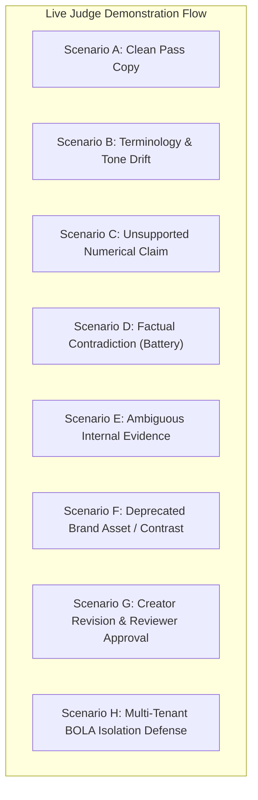

# BrandProof — Demonstration & Hackathon Submission Plan

**Document Version:** 1.0.0-PLANNING  
**Lifecycle Status:** Phase 0 — Showcase & Presentation Blueprint  
**Demonstration Entity:** Fictional Enterprise "Apex Dynamics Inc." (Autonomous Industrial Drone Manufacturer)

---

## 1. Demonstration Organization & Knowledge Seed

To demonstrate real dynamic verification without hardcoded shortcuts, a realistic, cohesive synthetic knowledge base is planned for **Apex Dynamics Inc.**:

### 1.1 Registered Knowledge Assets
1. **Brand Guidelines Manual (`apex_brand_manual.pdf`):**
   - Brand Voice: Authoritative, engineering-focused, precise. Forbid marketing hyperbole (*"unmatched"*, *"revolutionary"*, *"magical"*).
   - Terminology: Always write company as **Apex Dynamics** (never *Apex*, *ApexDrone*, or *apex dynamics*). Core platform is **ApexOS Enterprise**.
   - Mandatory Disclaimers: Any projection of battery life or payload range must state: *"Results based on ISO standard flight tests; real-world conditions may vary."*
2. **Approved Fact Registry (`approved_facts`):**
   - Fact 1: Maximum flight time is **42 minutes** (Source: *Apex-X4 Flight Cert v1.2*).
   - Fact 2: Maximum payload capacity is **5.5 kilograms** (Source: *Hardware Engineering Spec v3.0*).
   - Fact 3: Operating temperature range: **-10°C to 45°C** (Source: *Environmental Stress Test Report 2025*).
   - Fact 4: ISO 9001 certification: **Active until Nov 2027**; ISO 27001 certification: **Expired Dec 2025** (renewal in progress).
3. **Approved Asset Registry (`brand_assets`):**
   - Active: Apex Hexagonal Primary Logo (Cyan & Slate, 2026).
   - Deprecated: Apex 2022 Flat Emblem (Red & Black).

---

## 2. The 8 Comprehensive Demonstration Scenarios

### Scenario A: Fully Compliant Blog Post (Clean Pass)
- **Initial Data:** Blog post announcing the Apex-X4 industrial drone.
- **Content:** *"Apex Dynamics is proud to introduce the Apex-X4. Engineered for precision surveying, the system delivers up to 42 minutes of flight time under standard operational parameters."*
- **Action:** Creator clicks *"Run Governance Scan"*.
- **System Behavior:** Claim extracted -> Hybrid search finds Fact #1 -> NLI confirms `VERIFIED_SUPPORT` -> Zero policy violations -> Risk Score: **0 / LOW**.
- **Human Decision:** Fast-tracked for immediate scheduling.

### Scenario B: Terminology & Tone Drift
- **Initial Data:** Social media draft written by external agency copywriter.
- **Content:** *"Our revolutionary new apex drone will blow your mind with magical flight capabilities!"*
- **System Behavior:** Deterministic trie flags prohibited term *"apex drone"* -> Contextual evaluator flags hyperbole *"revolutionary"*, *"magical"*.
- **Findings Displayed:** 2 findings. Suggestion: *"Apex Dynamics drone"*, *"exceptional"*.
- **Human Decision:** Creator accepts 1-click suggestion; text updates in real-time.

### Scenario C: Unsupported Promotional Claim (Improvement A)
- **Initial Data:** Sales email draft.
- **Content:** *"Apex Dynamics is officially ranked the #1 drone manufacturer in North America by customer satisfaction."*
- **System Behavior:** Claim extracted: *"Ranked #1 in North America"*. Hybrid search returns 0 corroborating facts in the Knowledge Base (similarity < 0.40).
- **Finding Displayed:** `UNSUPPORTED_CLAIM` (Severity: `HIGH`). Citation notes: *"No customer ranking documentation found in Apex Dynamics Knowledge Base."*
- **Human Decision:** Creator requested to remove statement or provide verified third-party audit documentation.

### Scenario D: Factual Contradiction with Approved Engineering Truth (Improvement A)
- **Initial Data:** Press release draft.
- **Content:** *"The new Apex-X4 features an unprecedented 60 minutes of uninterrupted flight time."*
- **System Behavior:** Claim extracted: *60 minutes flight time*. Retrieved Fact #1 states: *42 minutes*.
- **Finding Displayed:** `FACTUAL_CONTRADICTION` (Severity: `CRITICAL`). Cites: *Apex-X4 Flight Cert v1.2, p. 8*.
- **Risk Score:** Jumps to **65 / HIGH** -> Auto-routes to Compliance Reviewer queue.

### Scenario E: Ambiguous / Conflicting Internal Sources
- **Initial Data:** Technical collateral mentioning temperature limits.
- **Content:** *"Operates reliably in extreme cold down to -25°C."*
- **System Behavior:** Retrieved Fact #3 states: *-10°C to 45°C*, while an old marketing whitepaper claims *-25°C*. System flags `AMBIGUOUS_EVIDENCE` (Confidence: 0.62).
- **Human Decision:** Reviewer escalates to Engineering Lead to confirm true thermal limits.

### Scenario F: Obsolete Visual Asset & Contrast Failure
- **Initial Data:** Digital banner containing the retired 2022 Apex logo with low-contrast light grey text.
- **System Behavior:** Perceptual hashing matches deprecated asset with Hamming distance = 2 -> Luminance analyzer flags text contrast at 3.1:1.
- **Finding Displayed:** `DEPRECATED_ASSET` warning + `ACCESSIBILITY_VIOLATION` (Fails WCAG AA 4.5:1).

### Scenario G: End-to-End Human Revision & Approval Cycle (Improvement C)
- **Workflow:** 
  1. Reviewer Jordan reviews Scenario D draft.
  2. Jordan clicks *"Request Changes"* with note: *"Please correct flight time to 42 minutes per cert."*
  3. Creator Alex receives notification, accepts suggested correction *"42 minutes"*, and clicks *"Submit Revision"*.
  4. BrandProof creates `Version 2`, re-scans automatically, confirms 0 critical violations.
  5. Reviewer Jordan executes `APPROVE`. Status moves to `APPROVED`. Full audit log recorded.

### Scenario H: Unauthorized Cross-Tenant Attempt (Security Defense)
- **Attack Simulation:** Malicious user authenticated under "Beta Corp" attempts to fetch `/api/v1/submissions/sub-apex-101` (owned by Apex Dynamics).
- **System Behavior:** Scoping middleware intercepts query -> Returns `404 Not Found` (or `403 Forbidden`). Zero metadata leaked.

---

## 3. Live Video Pitch & Walkthrough Outline (3 Minutes)

- **[0:00 - 0:35] The Problem:** Open with the brand entropy crisis—AI copywriters and marketing teams publishing unverified claims, risking FTC penalties and reputation damage.
- **[0:36 - 1:15] Brand Policy Compiler (Improvement B):** Show an admin uploading a 40-page brand manual. Watch BrandProof extract structured rules, categorize deterministic vs contextual policies, and version them upon admin approval.
- **[1:16 - 2:05] The Review Workspace & Evidence Ledger (Improvement A):** Paste the press release with the false "60 minute" battery claim. Watch the engine extract atomic claims in real time, query the approved facts, flag the contradiction with exact source citation, and propose the intent-preserving "42 minute" correction.
- **[2:06 - 2:35] Risk-Based Routing & Human Sign-off (Improvement C):** Show the composite risk score in action. Reviewer requests changes; author accepts; version diff confirms zero new errors; reviewer grants final sign-off.
- **[2:36 - 3:00] Governance Learning & Defense:** Showcase the Governance Analytics dashboard showing recurring policy confusion and display the automated AI benchmark scorecard proving 95%+ precision.

---

## 4. Hackathon Integrity & Disclosure Declaration

- **Greenfield Confirmation:** All project code is built entirely from scratch during the hackathon window.
- **AI Coding Disclosure:** AI coding assistants (Gemini 3.8 / Antigravity IDE) were utilized for pair programming, documentation generation, and unit test formulation.
- **Open-Source Libraries:** standard permissively-licensed libraries (FastAPI, React, Pydantic, PyMuPDF, SQLAlchemy) used without proprietary templates.
- **Honest Limitations:** Visual checks rely on 2D perceptual hash and contrast math; complex 3D brand asset geometry is identified as future roadmap work.
