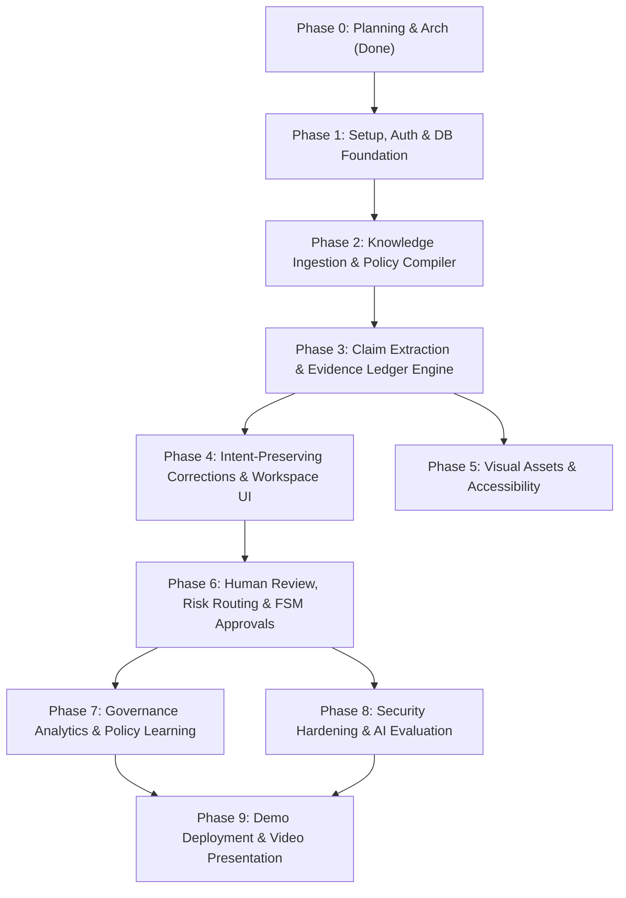

# BrandProof — Detailed Development Roadmap & Engineering Tasks

**Document Version:** 1.0.0-PLANNING  
**Lifecycle Status:** Phase 0 — Engineering Execution Schedule  
**Target Delivery Window:** Structured Iteration (Round 1 Planning -> Round 2 Build -> Round 3 Polish)

---

## 1. Roadmap Overview & Dependency Graph



---

## 2. Phase-by-Phase Task Breakdown

### Phase 0: Planning, Architecture & Workspace Audit
- **Status:** **COMPLETED**
- **Deliverables:** Workspace Inspection Report, 13 Planning Documents, Benchmark Test Dataset.
- **Priority:** P0

---

### Phase 1: Foundation, Multi-Tenant Database & Authentication
- **Objective:** Establish the clean repository layout, configure dual-dialect SQLAlchemy (SQLite local / PostgreSQL prod), and implement secure JWT authentication with tenant scoping.
- **Dependencies:** Phase 0 approval.
- **Priority:** P0 (MVP)
- **Estimated Effort:** 4–6 engineering hours.
- **Expected Files:**
  - `backend/app/main.py`
  - `backend/app/core/config.py`, `backend/app/core/security.py`
  - `backend/app/db/session.py`, `backend/app/db/base.py`, `backend/app/models/*.py`
  - `backend/app/api/auth.py`
  - `frontend/src/App.tsx`, `frontend/src/services/api.ts`
- **Database Changes:** Tables `organizations`, `users`, `audit_events`.
- **API Contracts:** `POST /api/v1/auth/login`, `GET /api/v1/auth/me`.
- **Frontend Changes:** Sign-in screen, auth state provider, navigation header with tenant branding.
- **Tests:** Token signing/decoding tests, tenant scoping DB tests, login endpoint tests.
- **Definition of Done:** User can log in; issued JWT contains `organization_id` and `role`; protected routes reject unauthenticated requests.

---

### Phase 2: Knowledge Base & Brand Policy Compiler (Signature Improvement B)
- **Objective:** Implement the Approved Fact Registry and the Brand Policy Compiler to convert raw guidelines into versioned, typed rules.
- **Dependencies:** Phase 1.
- **Priority:** P1 (Core Differentiator)
- **Estimated Effort:** 6–8 engineering hours.
- **Expected Files:**
  - `backend/app/services/parser.py` (PyMuPDF / python-docx extractor)
  - `backend/app/services/compiler.py` (LLM-assisted policy compiler)
  - `backend/app/api/knowledge.py`
  - `frontend/src/pages/KnowledgeBasePage.tsx`, `frontend/src/components/PolicyCompilerModal.tsx`
- **Database Changes:** Tables `brand_guidelines`, `policies`, `policy_versions`, `approved_facts`.
- **API Contracts:** `POST /api/v1/knowledge/facts`, `POST /api/v1/knowledge/policies/compile`, `POST /api/v1/knowledge/policies/{id}/approve`.
- **Frontend Changes:** Fact management table, guideline uploader, policy candidate review card.
- **Tests:** Parser unit tests, compiler candidate extraction tests, policy versioning tests.
- **Definition of Done:** Admin can upload brand PDF, review compiled rules, approve policy versions, and register approved facts.

---

### Phase 3: Claim Extraction & Evidence Ledger Engine (Signature Improvement A)
- **Objective:** Deconstruct submitted content into atomic claims, execute hybrid retrieval (BM25 + Cosine) over approved facts, and classify factual alignment with traceable citations.
- **Dependencies:** Phase 2.
- **Priority:** P0 (MVP Core Differentiator)
- **Estimated Effort:** 8–10 engineering hours.
- **Expected Files:**
  - `backend/app/services/extractor.py` (Structured JSON claim extractor)
  - `backend/app/services/retrieval.py` (BM25 + Cosine similarity)
  - `backend/app/services/ledger.py` (NLI verification discriminator)
  - `backend/app/api/submissions.py`
- **Database Changes:** Tables `content_submissions`, `submission_versions`, `extracted_claims`, `review_findings`, `evidence_references`.
- **API Contracts:** `POST /api/v1/submissions`, `POST /api/v1/submissions/{id}/analyze`.
- **Frontend Changes:** Submission creation form, basic scan progress indicator.
- **Tests:** Claim extraction benchmark tests, contradiction detection tests, grounding citation integrity tests.
- **Definition of Done:** Submitting copy with incorrect battery life flags `FACTUAL_CONTRADICTION` with exact citation to approved spec sheet.

---

### Phase 4: Intent-Preserving Corrections & Review Workspace UI
- **Objective:** Build the interactive, side-by-side review workspace with character-span highlighting, citation inspector, and 1-click intent-preserving correction generator.
- **Dependencies:** Phase 3.
- **Priority:** P0 (MVP Core Experience)
- **Estimated Effort:** 6–8 engineering hours.
- **Expected Files:**
  - `backend/app/services/corrector.py` (Contextual rewrite generator with self-check)
  - `frontend/src/pages/ReviewWorkspacePage.tsx`
  - `frontend/src/components/AnnotatedTextViewer.tsx`
  - `frontend/src/components/FindingCard.tsx`
  - `frontend/src/components/EvidenceCitationModal.tsx`
- **API Contracts:** `POST /api/v1/submissions/{id}/findings/{id}/correct`.
- **Frontend Changes:** Responsive dual-pane workspace, highlighted text offsets, diff comparison view.
- **Tests:** Off-by-one span validation tests, correction generator non-hallucination tests.
- **Definition of Done:** Reviewer clicks finding; evidence card pops up with exact quote; 1-click button replaces draft text seamlessly.

---

### Phase 5: Visual Assets & Accessibility Scanner
- **Objective:** Implement perceptual hash logo detection against registered assets and WCAG 2.1 AA color contrast analysis.
- **Dependencies:** Phase 3.
- **Priority:** P2 (High-Value Round 3 Polish)
- **Estimated Effort:** 4–6 engineering hours.
- **Expected Files:**
  - `backend/app/services/vision.py` (pHash and luminance contrast analyzer)
  - `backend/app/api/assets.py`
  - `frontend/src/pages/AssetRegistryPage.tsx`
- **Database Changes:** Table `brand_assets`.
- **API Contracts:** `POST /api/v1/assets`, `POST /api/v1/assets/verify-image`.
- **Frontend Changes:** Registered logo gallery, image upload dropzone with contrast heatmap.
- **Tests:** pHash threshold tests, luminance calculation tests.
- **Definition of Done:** Uploading image with deprecated logo flags warning; low contrast text (<4.5:1) is detected.

---

### Phase 6: Human Review, Risk Routing & FSM Approvals (Signature Improvement C)
- **Objective:** Implement deterministic risk index scoring, role-gated approval state machine, reviewer comments, and revision rounds.
- **Dependencies:** Phase 4.
- **Priority:** P0 (MVP Workflow)
- **Estimated Effort:** 5–7 engineering hours.
- **Expected Files:**
  - `backend/app/services/workflow.py` (Risk formula & FSM transition guards)
  - `backend/app/api/workflow.py`
  - `frontend/src/pages/SubmissionsQueuePage.tsx`
  - `frontend/src/components/ApprovalDecisionModal.tsx`
- **Database Changes:** Tables `review_assignments`, `approval_decisions`.
- **API Contracts:** `POST /api/v1/submissions/{id}/review/decision`, `POST /api/v1/submissions/{id}/revisions`.
- **Frontend Changes:** Review queue with risk badge filters, revision history timeline.
- **Tests:** FSM guard tests (creators cannot approve; high-risk requires compliance role).
- **Definition of Done:** High-risk draft cannot be marked approved by ordinary creators; full audit trail persisted.

---

### Phase 7: Governance Analytics & Continuous Policy Learning (Signature Improvement C)
- **Objective:** Build the organization brand health dashboard and the Policy Ambiguity Clustering engine that suggests guideline improvements based on recurring errors.
- **Dependencies:** Phase 6.
- **Priority:** P1 (Build Phase - Improvement C)
- **Estimated Effort:** 4–6 engineering hours.
- **Expected Files:**
  - `backend/app/services/learning.py` (Dispute clustering and amendment generator)
  - `backend/app/api/analytics.py`
  - `frontend/src/pages/AnalyticsDashboardPage.tsx`
- **API Contracts:** `GET /api/v1/analytics/overview`, `GET /api/v1/analytics/learning/recommendations`.
- **Frontend Changes:** Telemetry dashboard with charts (violation breakdown, resolution speed, top triggered policies).
- **Tests:** Analytical query aggregation tests, ambiguity clustering tests.
- **Definition of Done:** Dashboard reflects real DB records; system generates human-readable policy clarification suggestions without auto-updating rules.

---

### Phase 8: Security Hardening & AI Evaluation Benchmark
- **Objective:** Execute the automated test suite, run the 20-case AI evaluation benchmark, and harden API security.
- **Dependencies:** Phases 1–7.
- **Priority:** P0 (Hackathon Defense)
- **Estimated Effort:** 4–5 engineering hours.
- **Expected Files:**
  - `eval/test_claims.json`, `eval/run_eval.py`
  - `backend/tests/security/test_isolation.py`, `backend/tests/security/test_injections.py`
- **Tests:** Run full `pytest` suite; run `python eval/run_eval.py` and capture output metrics.
- **Definition of Done:** 100% test pass on tenant boundaries; AI benchmark report generated and documented.

---

### Phase 9: Deployment, Documentation & Demo Packaging
- **Objective:** Prepare production deployment configuration, seed the demonstration organization ("Apex Robotics"), record walkthrough video, and package submission materials.
- **Dependencies:** Phase 8.
- **Priority:** P0 (Final Submission)
- **Estimated Effort:** 4–5 engineering hours.
- **Expected Files:**
  - `backend/seed_demo_data.py`
  - `docs/DEMO_AND_SUBMISSION_PLAN.md` (Updated with live URLs and video links)
  - Deployment configuration (`Dockerfile`, `docker-compose.yml`, cloud scripts).
- **Definition of Done:** Clean one-click seed command initializes full demonstration story; video script rehearsed.

---

## 3. Compressed Hackathon Schedule (48-Hour Sprint Alignment)

```
[Hours 00-06] Phase 1: Repo Setup, SQLite/FastAPI Scaffold, Auth & Tenant Guard
[Hours 07-14] Phase 2: Knowledge Base, Fact Registry & Brand Policy Compiler (Impr. B)
[Hours 15-24] Phase 3: Ingestion, Claim Extraction & Evidence Ledger Engine (Impr. A)
[Hours 25-32] Phase 4: Intent-Preserving Corrections & Side-by-Side Review Workspace
[Hours 33-38] Phase 6: Risk-Based Routing, FSM Approvals & Audit Trail (Impr. C)
[Hours 39-42] Phase 7 & 5: Governance Analytics & Visual Asset Checks
[Hours 43-46] Phase 8: Ground-Truth AI Benchmark & Security Validation
[Hours 47-48] Phase 9: Demo Data Seeding, Video Recording, and Documentation Wrap
```

---

## 4. Team Contribution Matrix (Placeholders)

| Responsibility Domain | Primary Lead | Supporting Peer | Key Deliverables |
| :--- | :--- | :--- | :--- |
| **Architecture & Backend Lead** | *[Team Member 1]* | *[Team Member 2]* | FastAPI, SQLAlchemy schema, Evidence Ledger, Auth |
| **Frontend & UX Lead** | *[Team Member 2]* | *[Team Member 1]* | React 19 SPA, Review Workspace, Diff Viewer, Design Tokens |
| **AI/ML & Evaluation Engineer** | *[Team Member 3 / AI Pair]*| *[Team Member 1]* | NLI verification prompts, Benchmark dataset, Eval runner |
| **Security & Compliance Auditor**| *[Team Member 4]* | *[Team Member 3]* | BOLA tests, Prompt injection defense, Threat modeling |
